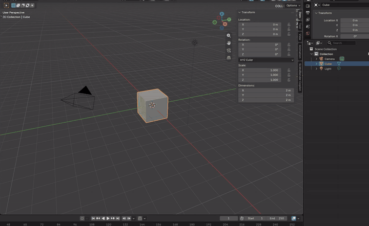
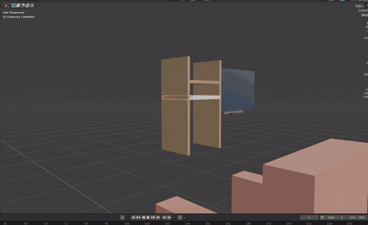
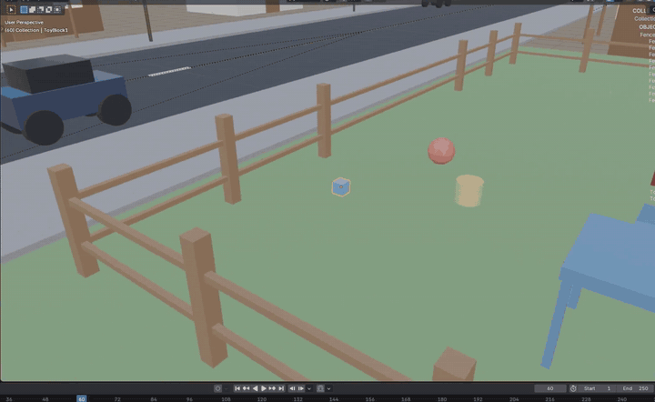
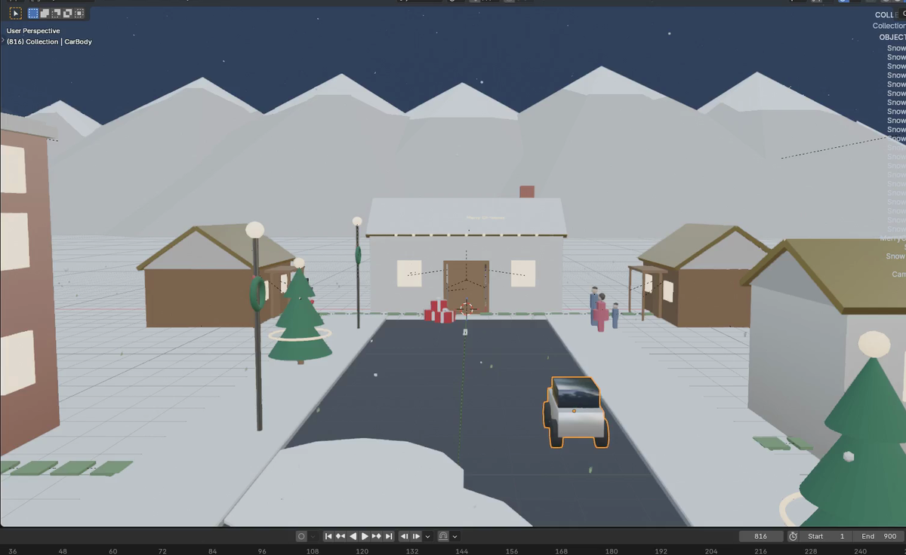

<div align="center">

# Maris3D

**The small language model (SLM) for Blender.**<br>
Type a sentence, get a scene. Offline, on an 8 GB laptop.

[](https://huggingface.co/slm4apps/Maris3D-Blender)
[](https://github.com/slm4apps/maris3d/releases)
[](https://github.com/slm4apps/maris3d/actions/workflows/ci.yml)
[](LICENSE)
[-orange)](https://www.blender.org)



</div>

Maris3D-SLM-Blender-0.5B (v0.1) is a 0.5B model that builds and edits Blender scenes by calling 26 native Blender tools. It runs on your own machine: 0.58 GB of memory, about 0.6 s per answer, no cloud, no account. It is an **early** model: about 3 in 4 requests come out usable.

## Install

You do not need to clone this repository. One command installs the Blender add-on, downloads the model from Hugging Face (about 540 MB, sha256-checked) and tests it in your Blender.

| macOS / Linux | Windows (PowerShell) |
|---|---|
| `curl -fsSL https://raw.githubusercontent.com/slm4apps/maris3d/main/install.sh \| sh` | `powershell -ExecutionPolicy ByPass -c "irm https://raw.githubusercontent.com/slm4apps/maris3d/main/install.ps1 \| iex"` |

You need Python 3.9+ and Blender 4.2 or newer. The installer asks before each step; add `-s -- --express` after `sh` to say yes to everything. It touches nothing outside `~/.local/share/maris3d`, `~/.cache/maris3d` and your Blender add-ons folder.

<details>
<summary>Other ways to install (pip, an existing Ollama / LM Studio, by hand)</summary>

- **With pip** in any environment you like: `pip install git+https://github.com/slm4apps/maris3d`, then `maris3d install`.
- **Already run Ollama, llama-server or LM Studio?** `maris3d install` finds a running server and reuses it. To build the command yourself: `python3 -m maris3d.setup serve-command <model.gguf> [edit-lora.gguf]`, then `python3 -m maris3d.setup smoke`.
- **Just the model files:** [slm4apps/Maris3D-Blender](https://huggingface.co/slm4apps/Maris3D-Blender) on Hugging Face. Serving notes: [SERVE.md](hf/Maris3D-Blender/SERVE.md).
- Something wrong? `maris3d doctor` checks every part and says what to fix.

</details>

## Quick start

1. `maris3d serve start` (one local server, 512 MB).
2. Open Blender. Press `N` in the 3D View and pick the **Maris3D Copilot** tab.
3. Type a sentence, press **Run**. Leave the switch on **Auto**; it picks Build or Edit for you.

Three things to try:

| Build one thing | Build a whole scene | Change what is there |
|---|---|---|
| `a small house` | `a park with a bench, a tree behind the bench and a lamp next to the bench` | `Make the bench blue.` then `Move the lamp to the left of the bench.` |

Every answer shows the tool calls as they run, then a one-line summary read from the real scene. **Undo** takes back the whole answer in one step. More words and examples: [docs/PROMPTING-GUIDE.md](docs/PROMPTING-GUIDE.md).

## See it work

Screen recordings from Blender 5.2 on a 2015 laptop with a 4 GB GPU, sped up. Videos come with v0.2.

| a living room, thing by thing (10x) | walls go up around it, cut away to look in (6x) |
|---|---|
|  |  |
| **the play park (8x)** | **the finished street** |
|  |  |

**The Christmas street, row by row** ([demo/christmas-street/](demo/christmas-street/README.md)): the model makes each shape it is asked for; code places, colours and groups them (that folder's README gives the exact split).

## How it works

- The model only emits Blender tool calls. A small copilot (`src/maris3d/copilot/`) turns them into Blender Python and runs them. Nobody, neither the model nor a host model, writes or runs Blender code.
- **Build and edit, one process:** the q8_0 base is served with a 5.6 MB edit adapter. The copilot asks for adapter scale 0 on a fresh scene and 1.0 on a change.
- **Plan first:** a 5.6 MB planner adapter reads a sentence that names several things ("a platform, a station building behind the platform, a track in front of it"). It writes the things and their places in words; code turns them into exact instructions; the edit adapter makes each part; a check reads every part back and corrects it. It knows 40 everyday things by name.

## Scores

Measured on 180 frozen Blender requests. PASS = fully correct; usable = PASS or needs a small fix.

| Variant | PASS | usable |
|---|---|---|
| **Product: q8_0 base + edit adapter** | **49/180 (27.2%)** | **136/180 (75.6%)** |
| Single-file fallback: edit LoRA merged, q8_0 | 35/180 (19.4%) | 139/180 (77.2%) |
| Strict mode: base + edit LoRA at scale 0.7 | 23.9% | 68.9% |
| Base alone, q8_0 | 39/180 (21.7%) | 124/180 (68.9%) |
| q4_k_m + edit LoRA @1.0 | 36/180 (20.0%) | 143/180 (79.4%) |
| *Untrained Qwen2.5-Coder-0.5B / 1.5B* | *0.0%* | *0.0%* |
| *Untrained Qwen3-1.7B* | *5.0%* | *12.8%* |

<details>
<summary>Breakdown and public benchmarks</summary>

- Product halves: build 24.0% pass / 73.3% usable (150 rows), edit 43.3% / 86.7% (30 rows).
- Per-file on edit requests (of 30, usable): merged fallback 26, strict 24, base 14, q4+LoRA 26. Build requests (of 120, usable): merged fallback 94 (78.3%), strict 82, base 87 (72.5%), q4+LoRA 96 (80.0%).
- Public benchmarks (4 Nov 2026, same settings for every model): 3DCodeBench scenes that run 212/212 (plain 0.5B 0/212, Qwen3.5-0.8B 0/212); BFCL v4 simple_python 49.25%.
- Details: [docs/BENCHMARKS.md](docs/BENCHMARKS.md). Figures: [pass and usable vs untrained base models](docs/figures/comparison-180.svg) · [public benchmarks vs other models](docs/figures/external-benchmarks.svg).

</details>

## Limits

- **Not reliable yet:** about 1 in 4 requests still needs a fix. Multi-part scenes are the weakest build mode.
- **One request at a time:** v0.1 starts a fresh conversation per request, so say what to change ("Make the bench blue", not "make it blue"). Multi-turn steering: 0/30 sessions.
- **Plan first knows 40 things** and does not design new ones; a change to the scene is not read back and checked. Both are what v0.2 is for ([ROADMAP.md](ROADMAP.md)).
- Not a general tool caller (BFCL v4 simple_python 49.25%). Does not see the scene or images. Knows 26 Blender tools only.

## Files

The model files live in the Hugging Face organisation `slm4apps`, repository [slm4apps/Maris3D-Blender](https://huggingface.co/slm4apps/Maris3D-Blender). The installer fetches the first three.

<details>
<summary>All five files with sizes and sha256</summary>

| File | What it is | Size |
|---|---|---|
| `maris3d-slm-blender-0.5b-q8_0.gguf` | **the base of the product**, served with the edit adapter | 531,068,000 bytes |
| `maris3d-slm-blender-0.5b-edit-lora-f16.gguf` | the edit adapter (scale 0 fresh, 1.0 correction, 0.7 strict) | 5,881,344 bytes |
| `maris3d-slm-blender-0.5b-planner-v31-lora-f16.gguf` | the planner adapter for plan first | 5,881,248 bytes |
| `maris3d-slm-blender-0.5b-edit-q8_0.gguf` | single-file **fallback** for hosts without adapter support (edit LoRA merged) | 531,067,872 bytes |
| `maris3d-slm-blender-0.5b-q4_k_m.gguf` | smaller build-only weights | 397,807,712 bytes |
| `MANIFEST.json` | the current file of each role with its sha256; `maris3d update` fetches only what changed | |

sha256:
- base q8_0 `5604f0e2480ca5555a8d79a50ec87baeea64fdf50d0340f004ed099b08b95dd2`
- planner `8a315eaa440e732a81bb2cef245448f949d3b352bf428c371756bedea2ce7e74` (on 300 held-out sentences: relation right 98.6%, the thing it is placed by 87.3%, 98.5% when every name was trained)
- merged fallback `2879a3014ccfa070a569a7817f11401ff2c17544f22170ffd9ab1fe2342b10e9`
- q4_k_m `e4ff8a9560a4fff4be6007e5e24b24df3c4ebb8598ffd2d4849641f5654de5f2`
- all files: `SHA256SUMS` in the Hugging Face repository.

Model card: [hf/Maris3D-Blender/](hf/Maris3D-Blender/README.md). Release write-up: [docs/release-v0.1.md](docs/release-v0.1.md).

</details>

## Other ways to use it

<details>
<summary>MCP server, inside another Blender MCP, the panel in detail</summary>

- **MCP server** (stdio, standard library only): `maris3d-mcp` (or `python3 -m maris3d.mcp.server`). Tools: `build_scene`, `edit_scene`, `run_calls` (native calls from a host model), `scene_info`, `undo`, `look`. It attaches to, or launches, a Blender window with the live add-on (`src/maris3d/blender/live_server.py`, port 9877).
- **Inside another Blender MCP** (`executors/mcp_forward.py`): the native calls are compiled to Python and sent through that MCP's execute tool.
- **The panel:** long prompts open in a multi-line text area with the page icon. The sidebar opens itself on startup and on every file load. The summary is built from the real scene diff, never from the model's words. No MCP anywhere in this path.
- **Updates:** `maris3d update` fetches a new adapter version; the base is not downloaded again.
- Details and examples: [docs/USAGE.md](docs/USAGE.md).

</details>

## Work on the code

```bash
git clone https://github.com/slm4apps/maris3d && cd maris3d
PYTHONPATH=src python3 -m unittest discover -s tests -q    # plain unittest, no pytest needed
PYTHONPATH=src python3 -m maris3d.cli --help                # or: pip install -e .
PYTHONPATH=src python3 scripts/release_check.py
```

The package has zero dependencies; Blender's bundled Python is all the add-on needs. Add-on sources: `src/maris3d/addon/` (the Blender UI, the build/edit rule in `routing.py`, the per-request adapter scale in `client.py`). See [CONTRIBUTING.md](CONTRIBUTING.md).

<details>
<summary>Previous models (old JSON format)</summary>

The earlier Maris3D 0.5B v3 and 1.5B v2 answered in a fixed JSON format and used a different, earlier 206-prompt benchmark; their scores (0.5B: 59.7% bare, 63.1% with retry; 1.5B: 72.33% bare; untrained 0.5B 27.7%, untrained 1.5B 48.5%) belong to that earlier generation and are not comparable with v0.1.
Three pages in `docs/` (`PROMPT-FORMAT.md`, `EVALUATION.md`, `DATA-CARD.md`) still describe those old models and carry a status banner saying so; `TECHNICAL-REPORT.md` describes v0.1.

</details>

## Support the project

Maris3D is built and trained by one person on home machines. If it is useful to you, you can support the next versions on [Ko-fi](https://ko-fi.com/zinoadidi) or [Buy Me a Coffee](https://buymeacoffee.com/zinoadidi).

## Licences

Weights Apache-2.0 (following the base, Qwen2.5-Coder-0.5B-Instruct by Alibaba Cloud / Qwen team, Apache-2.0); code Apache-2.0; files that import `bpy` GPL-3.0-or-later. Details: [docs/LICENSING.md](docs/LICENSING.md), [NOTICE](NOTICE).

> Independent community project, not affiliated with or endorsed by the Blender Foundation. "Blender" is a trademark of the Blender Foundation.
