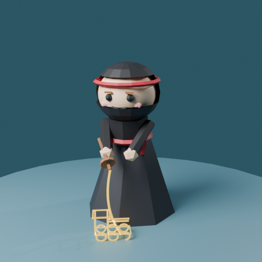
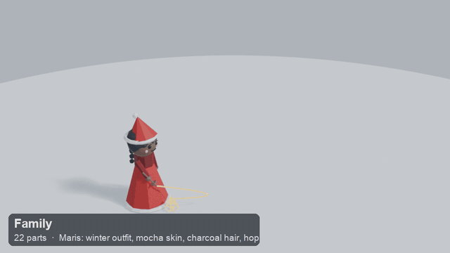
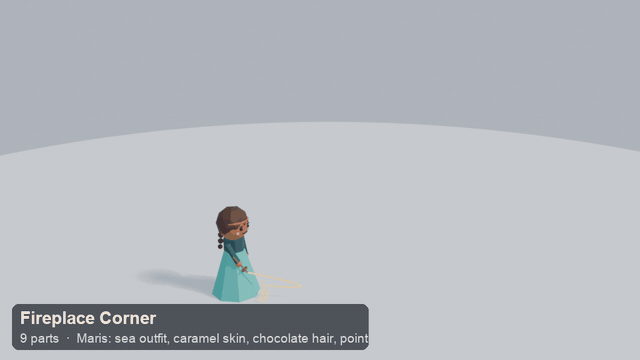
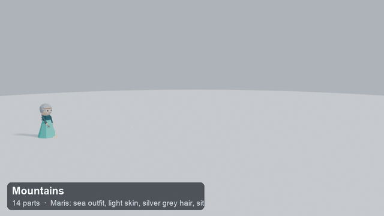
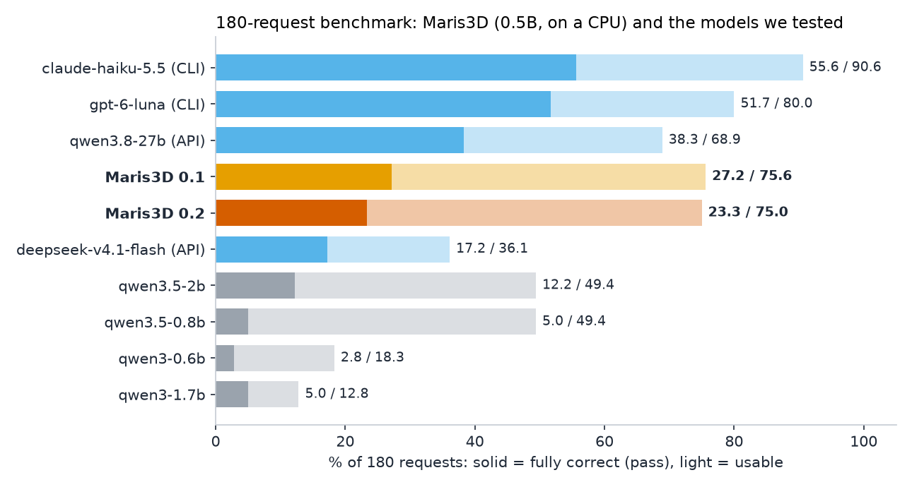

<div align="center">

# Maris3D

**The small language model (SLM) for Blender.**<br>
Type a sentence, get a scene. Offline, on your own machine.

[](https://huggingface.co/slm4apps/Maris3D-Blender)
[](https://github.com/slm4apps/maris3d/releases)
[](https://github.com/slm4apps/maris3d/actions/workflows/ci.yml)
[](LICENSE)

[-orange)](https://www.blender.org)


</div>



Maris3D 0.2.2 is a 0.5B model and a Blender add-on. You describe a scene in a sentence. The model
answers in plain words: which things, how many, what they are made of and where they stand. The
app turns those words into exact Blender tool calls, builds the scene, reads it back and checks it.
The model never writes a number; code computes every size and position. No cloud, no account, no
API key: the model is one 531 MB base file plus a 23 MB adapter.

## Install

You do not need to clone this repository. One command installs the Blender add-on, downloads the model from Hugging Face (about 554 MB, sha256-checked) and tests it in your Blender.

| macOS / Linux | Windows (PowerShell) |
|---|---|
| `curl -fsSL https://raw.githubusercontent.com/slm4apps/maris3d/main/install.sh \| sh` | `powershell -ExecutionPolicy ByPass -c "irm https://raw.githubusercontent.com/slm4apps/maris3d/main/install.ps1 \| iex"` |

You need Python 3.9+ and Blender 4.2 or newer. The installer asks before each step; add `-s -- --express` after `sh` to say yes to everything.

<details>
<summary>Other ways to install (pip, an existing Ollama / llama-server, by hand)</summary>

- **With pip:** `pip install git+https://github.com/slm4apps/maris3d`, then `maris3d install`.
- **Ollama:** download the files from [slm4apps/Maris3D-Blender](https://huggingface.co/slm4apps/Maris3D-Blender), run `ollama create maris3d-slm-blender-0.5b -f Modelfile`, then pick Ollama in the app's settings.
- **llama-server by hand:** `llama-server -m maris3d-slm-blender-0.5b-q8_0.gguf --lora maris3d-slm-blender-0.5b-v0.2.2-lora-f16.gguf --lora-init-without-apply --jinja -c 8192`. Serve with temperature 0 and repeat penalty 1.05 (the app sends both).
- Something wrong? `maris3d doctor` checks every part and says what to fix.

</details>

## Quick start

1. `maris3d serve start` (one local server).
2. Open Blender. Press `N` in the 3D View and pick the **Maris3D Copilot** tab.
3. Type a sentence, press **Run**. Or press the mic button and say it (voice input, offline: `maris3d install --voice`).

Things to try:

| Build one thing | Build a whole scene | Change what is there | Move it |
|---|---|---|---|
| `a small house` | `a park with a bench, a tree behind the bench and a lamp next to the bench` | `Make the bench blue.` | `a ball bouncing twice` |

Every answer shows what was built, then a one-line summary read from the real scene. **Undo** takes back the whole answer in one step. More words and examples: [docs/PROMPTING-GUIDE.md](docs/PROMPTING-GUIDE.md).

Want one shape with your own numbers? Type them: `Add a cylinder named Cup at 0.45, 0.15, 0.86 with a radius of 0.10 and a depth of 0.18.` The numbers are copied as typed.

## What is new in 0.2.2

- **A new adapter** (`maris3d-slm-blender-0.5b-v0.2.2-lora-f16.gguf`, 23 MB) on the same base; update the app (re-run the one-line install), then `maris3d update` fetches only the adapter. It knows more change words: camera, light, text, retext, attach, aim, finish (bevel, subdivide, thicken, wire, mirror, array, taper, bend, twist) and scene (background colour, length, frame rate). The app tells the model which cameras, lights and texts are in the scene; `MARIS3D_KIT_WORDS=0` turns the new words off.
- **Exact adds are read by code.** `Add a cube named Path at -1, 0, 0 with a scale of 0.4, 2.0, 0.01` (or with a radius and depth, a major and minor radius, a rotation) is built from the numbers as written, without asking the model: 203 of the 204 exact adds of the 0.1 demo scene are built exactly.
- **Undo by voice or text:** "undo", "undo that", "go back" or "revert it" undoes the last request.
- **Voice input**, on your machine (see below).
- **Maris** behaves more like she lives in the scene: sized like a person, carries parts in from the edge of the ground, keeps facing what she placed, runs to a chair before she sits, carries a whole group when a request moves it. **Follow Maris** (off by default) lets the view drift after her.

### Voice input

1. `maris3d install --voice` (the interactive install asks too). It sets up whisper.cpp with a small English speech model; speech is turned into text on your machine.
2. You need a sound recorder: sox, ffmpeg, ALSA's `arecord`, or Windows' own.
3. In the **Maris3D Copilot** tab press the mic button next to the prompt, say what to make or change, press it again. The words fill the prompt and run.

## What is new in 0.2

- **Words, not numbers.** 0.1 wrote tool calls with coordinates. 0.2 answers in one small word language (things, relations such as *behind* or *on top of*, sizes such as *half* or *double*); the app's compiler writes the tool calls.
- **One adapter** for planning, designing the parts of a new thing, word edits and talk, instead of 0.1's separate edit and planner adapters.
- **Edits by words:** "make the table darker", "move the lamp next to the sofa". The model says what changes, code applies it and checks it.
- **Talk:** ask about the scene and it answers from what is there.
- **Animation:** spin, bounce, move, rise, grow, shrink, swing, orbit, pulse and colour change, written by the app's code.
- **Breaking change:** 0.2 needs the 0.2 app. 0.1 stays available at tag [v0.1.2](https://github.com/slm4apps/maris3d/releases/tag/v0.1.2) and as [Maris3D-Blender v0.1.0](https://huggingface.co/slm4apps/Maris3D-Blender/tree/v0.1.0).

## How it works

```
 your sentence
      |
 MODEL        the 0.5B model + one adapter answers in words: things, counts, materials, relations
      |
 COMPILER     code: words -> metres -> exact Blender tool calls
      |
 CHECK        code reads every part back from Blender and corrects it
      |
 your scene
```

Nothing is ever asked to write or run free-form code. More in
[docs/ARCHITECTURE.md](docs/ARCHITECTURE.md) and the [0.1 technical report](TECHNICAL-REPORT.md).

<details>
<summary>MCP server and other Blender MCPs</summary>

- **MCP server** (stdio, standard library only): `maris3d-mcp` (or `python3 -m maris3d.mcp.server`). Tools: `scene_request` (build, change or place things from a short request), `run_calls` (native calls from a host model), `scene_info`, `undo`, `look`. It attaches to, or launches, a Blender window with the live add-on.
- **Inside another Blender MCP** (`executors/mcp_forward.py`): the native calls are compiled to Python and sent through that MCP's execute tool.

</details>

## See it work

Screen recordings of the demo street being built in Blender 5.2 (recorded with 0.1), sped up, and
a render of the finished scene. Each thing is one typed request; the 204 requests of these demo
scenes, replayed through the 0.2.2 app, build **203 of 204 exactly** (right thing, place and size).


| the room, from the first table to the walls | the play park, from the first blade of grass |
|---|---|
|  |  |
| **the tree, the snowman, the gift, the bus and the people** | **the family, with Maris** |
|  |  |

## Meet Maris

Maris is the add-on's mascot (optional, off in renders by default): she weaves while the copilot
builds and reacts when it finishes. Here she stands beside groups of things from the demo street,
in a different outfit, skin, hair and pose each time; every part appears in turn, then a 360 turn.

| the fireplace corner | the mountain range |
|---|---|
|  |  |

Every recording and render is in [demo/gifs/](demo/gifs/README.md).

## Results

Held-out sets the model never trained on, scored by outcome through the app's own code (0.2.2).

| What | Result |
|---|---|
| Plan from one sentence: the things named are right | 97.3 % (2,951 of 3,033 things in 716 sentences) |
| the relation (behind, next to, on top of ...) is right | 97.1 % |
| the thing it is placed by is right | 95.9 % |
| the whole sentence is planned right | 84.1 % (602 of 716) |
| Parts of a new thing: the answer parses / passes the app's rules | 99.9 % / 99.0 % (1,268 names) |
| Word edits: the change asked for is the change made | 85.4 % (726 requests) |
| Talk: the reply is right | 96.1 % (152 turns), 96.5 % (231 turns, a second set); 0 invented things in 383 turns |
| Long sentences that join several groups of things: the whole plan exact | 40.0 % (60 sentences) |
| The 0.1 demo scene, its 204 exact adds through the 0.2.2 app (read by code): built exactly | 99.5 % (203 of 204) |

Both versions on every set: [docs/BENCHMARKS.md](docs/BENCHMARKS.md).

## Scores

Measured on 180 frozen Blender requests, the same set and scorer as 0.1 (run on 0.2.0; not run again for 0.2.2). PASS = fully correct;
usable = PASS or needs a small fix.

| Model | PASS | usable |
|---|---|---|
| **Maris3D 0.2: q8_0 base + the 0.2 adapter** | **42/180 (23.3%)** | **135/180 (75.0%)** |
| Maris3D 0.1: q8_0 base + edit adapter (0.1 card's run) | 49/180 (27.2%) | 136/180 (75.6%) |
| Maris3D 0.1: the same, router picking the adapter per request | 51/180 (28.3%) | 160/180 (88.9%) |
| *Untrained Qwen2.5-Coder-0.5B / 1.5B* | *0.0%* | *0.0%* |
| *Untrained Qwen3-1.7B* | *5.0%* | *12.8%* |



<details>
<summary>Breakdown and public benchmarks</summary>

- 0.2 halves: build 24.7% pass / 80.7% usable (150 rows), edit follow-ups 16.7% / 46.7% (30 rows). 0.1: build 24.0% / 73.3%, edit 43.3% / 86.7%.
- By mode, 0.2 pass / usable: single 22.5/97.5, multi-part 10.0/83.3, arrays and rings 40.0/70.0, parenting 5.6/66.7, geometry nodes 0.0/50.0, animation 53.3/83.3, edit 16.7/46.7.
- Public benchmarks, measured on 0.1 (4 Nov 2026, same settings for every model): 3DCodeBench scenes that run 212/212 (plain 0.5B 0/212, Qwen3.5-0.8B 0/212); BFCL v4 simple_python 49.25%. They score a model that writes tool calls itself; in 0.2 the app's compiler writes them.
- Details: [docs/BENCHMARKS.md](docs/BENCHMARKS.md). Figures: [0.1 and 0.2 by mode](docs/figures/per_mode.png) · [pass and usable vs untrained base models](docs/figures/comparison-180.svg) · [public benchmarks vs other models](docs/figures/external-benchmarks.svg).

</details>

Method and the rest: [docs/BENCHMARKS.md](docs/BENCHMARKS.md), the
[model card](hf/Maris3D-Blender/README.md) and [limits](docs/SAFETY-AND-LIMITATIONS.md).

## Limits

- **Early.** Plans and edits are measured on held-out sets above; whole scenes can still come out wrong. Check what it built.
- **Things only:** furniture, buildings, vehicles, people, plants, street and room scenes. No lights, cameras or text from a plain request yet; an animation that names a camera or a light gets a real one from the app's animation code, and from 0.2.2 a change to a built scene can add a camera, a light or a text.
- **Weakest modes:** edit follow-ups and geometry nodes (see Scores above).
- Does not see images.

## See what it built

[demo/](demo/README.md) holds a finished scene from version 0.1 as `.blend`, `.glb` and `.fbx`, with the text that was typed to make it, and one file per object if you want to reuse a bench or a snowman.


## Files

The model files live in the Hugging Face organisation `slm4apps`, repository [slm4apps/Maris3D-Blender](https://huggingface.co/slm4apps/Maris3D-Blender).

| File | What it is | Size |
|---|---|---|
| `maris3d-slm-blender-0.5b-q8_0.gguf` | the base (the same file as 0.1) | 531 MB |
| `maris3d-slm-blender-0.5b-v0.2.2-lora-f16.gguf` | the 0.2.2 adapter | 23 MB |
| `Modelfile` | the Ollama entry `maris3d-slm-blender-0.5b` | |
| `MANIFEST.json`, `SHA256SUMS` | the current file of each role with its sha256; `maris3d update` fetches only what changed | |

## Contributing

Use it on real work and tell us where it breaks: a failed prompt with what you expected is the
most useful thing you can send. Code, tests and result reports from other machines are welcome
too. Start with [CONTRIBUTING.md](CONTRIBUTING.md); questions go to [SUPPORT.md](SUPPORT.md);
conduct and security: [CODE_OF_CONDUCT.md](CODE_OF_CONDUCT.md), [SECURITY.md](SECURITY.md).

```sh
git clone https://github.com/slm4apps/maris3d && cd maris3d
PYTHONPATH=src python3 -m unittest discover -s tests -t .    # plain unittest, no extra packages
python3 scripts/scan_private.py && python3 scripts/release_check.py
```

History: [CHANGELOG.md](CHANGELOG.md). What is next: [ROADMAP.md](ROADMAP.md).

## Support the project

Maris3D is built and trained by one person on home machines. If it is useful to you, you can support the next versions on [Ko-fi](https://ko-fi.com/zinoadidi) or [Buy Me a Coffee](https://buymeacoffee.com/zinoadidi). Videos of Maris3D building scenes are on [YouTube](https://www.youtube.com/@SLMForApps).

## Licences and credits

Code and weights: Apache-2.0. Files that import `bpy` (the Blender add-on): GPL-3.0-or-later. Details in
[docs/LICENSING.md](docs/LICENSING.md) and [NOTICE](NOTICE). Built on Qwen2.5-Coder-0.5B-Instruct
(Alibaba Cloud / Qwen team, Apache-2.0). To cite: [CITATION.cff](CITATION.cff).

> Independent community project, not affiliated with or endorsed by the Blender Foundation.
> "Blender" is a trademark of the Blender Foundation.
