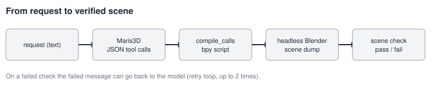
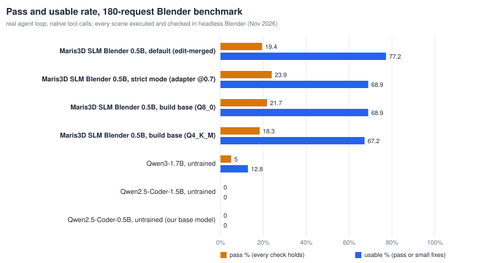
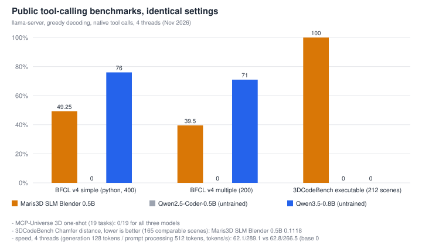

# Maris3D-SLM-Blender-0.5B: a small model that builds and edits Blender scenes by calling tools

Technical report for release v0.1. Every headline number below comes from a file — `release/CURRENT.json`, `docs/figures/` or the staged model card — named in an HTML comment next to it (view the Markdown source). The previous generation of models (fixed JSON tool format, 206-prompt benchmark) is described in a short section at the end; its scores are not comparable with the numbers in this report.

## Abstract

We fine-tune Qwen2.5-Coder-0.5B-Instruct with LoRA to answer a plain-English request with native Qwen tool calls from a fixed set of 26 Blender tools. A host runs the calls one at a time in an agent loop (up to 20 calls per user turn); a small copilot compiles each call into Blender Python, the script runs in Blender, and a per-request check decides whether the scene is right. On a 180-request benchmark the product (the build model served with the edit LoRA as an adapter: scale 0 on a fresh request, 1.0 on a correction) passes 27.2% of requests fully correct and 75.6% usable; the single-file fallback with the edit LoRA merged in passes 19.4% and 77.2%; the untrained base passes 0.0%. The model needs 0.58 GB of memory, answers in about 0.6 s, and runs offline on an 8 GB Mac. The training rows are text-only tool-call conversations that were run and checked in headless Blender before being kept; the data is not released (teacher terms still open). We also report what does not work: multi-turn steering (0 of 30 sessions) and general tool calling (49.25% on BFCL v4 simple_python against 76.0% for an untuned 0.8B model).

## 1. Introduction

Writing Blender scenes by hand needs the Python API or hours in the UI. Large models can write the code, but they are not local, not free, and they still make API errors. Small local models would remove cost and privacy concerns, but untuned ones are poor at this task: on our agent loop the untrained Qwen2.5-Coder-0.5B base passes 0.0% of the 180 requests, the untrained 1.5B passes 0.0%, and a Qwen3-1.7B manages 5.0% <!-- source: docs/figures/comparison-180.json -->. We ask how far supervised fine-tuning on *verified* tool-call data can take a model this small.

Contributions: (1) a 26-tool DSL with a compiler to Blender 5.2 Python; (2) a 180-request benchmark with machine checks, executed in headless Blender (the frozen set stays private so it remains a fair test; the earlier 206-prompt benchmark ships in `eval/benchmark/`); (3) one released model in four files with two serving modes — a default file with the edit LoRA merged, and a strict mode that runs the build base with the edit adapter at runtime scale 0.7; (4) a data pipeline that keeps only rows verified in Blender; (5) negative results.

## 2. Related work

Tool use and structured output: Toolformer and Gorilla teach models to call APIs; our model uses the base model's native Qwen tool-call format, so no grammar and no custom prompt code are needed. Blender and CAD generation with language models include BlenderLLM and SceneCraft, which generate Blender code with larger models or agents. Our setting differs: a tiny local model, a closed tool set, and verification by running Blender. Data creation by a stronger model (Self-Instruct style) and LoRA fine-tuning follow standard practice. Base model: Qwen2.5-Coder. Runtimes: llama.cpp and MLX.

## 3. Task and DSL

Input: one English request. Output: native Qwen tool calls — `{"name": ..., "arguments": ...}` — issued one at a time in an agent loop, at most 20 per user turn. The host runs each call, returns the result as a tool message, and the model decides the next call. The 26 tools cover primitives (with array, offset and ring options), lights, cameras, empties, curves, text, transforms, modifiers, materials, shading, UV unwrap, parenting, keyframes, collections, constraints, shape keys, geometry-node presets, mesh edits, duplicates, object settings, world and scene settings. The generated reference is [docs/DSL.md](docs/DSL.md). Unknown arguments are ignored by the compiler.

A closed tool set has a cost: requests that cannot be expressed with the tools cannot pass.

## 4. Training data

The training data is not released ([docs/DATA-CARD.md](docs/DATA-CARD.md)). What it is: text-only conversations — a user request and tool calls — with no images and no code from Blender itself. Procedure: a teacher model expands topic lists into prompts and writes the tool calls; every answer is compiled and run in headless Blender 5.2.2 and the prompt's scene check is evaluated; only rows that ran and passed are kept; near-duplicates of benchmark prompts and duplicates inside the data are removed. The teacher terms for releasing a model trained on these rows are an open item ([docs/LICENSING.md](docs/LICENSING.md)).

## 5. Training recipe

Two LoRA stages with `mlx_lm` on Apple silicon, both merged into the weights:

| Stage | What | Where | Notes |
|---|---|---|---|
| Build | LoRA rank 8 | the 7 linear modules plus `embed_tokens` and `lm_head` | merged into the base weights; this produces the build base (`maris3d-slm-blender-0.5b-q8_0.gguf`) |
| Edit | LoRA rank 8, alpha 160 (scale 20) | all 7 linear modules, layers 8-23 | 1 epoch; shipped as the adapter `maris3d-slm-blender-0.5b-edit-lora-f16.gguf`, and merged into the build base for the single-file fallback (`maris3d-slm-blender-0.5b-edit-q8_0.gguf`) |

The edit adapter also ships unmerged (`maris3d-slm-blender-0.5b-edit-lora-f16.gguf`) so it can be applied to the build base at runtime; scale 0.7 is the strict mode.

**The planner (added 12 Nov 2026).** A third LoRA (rank 8, alpha 160, PEFT, fp16, on a laptop GPU with 4 GB), never merged: `maris3d-slm-blender-0.5b-planner-v31-lora-f16.gguf`. It was trained on 4,000 rule-made sentences; each answer is one JSON object listing things, counts, materials and, in words only, the thing each one is placed by, the relation, the distance and the arrangement. Held out by phrasing and by name, 300 sentences: 297 parse; relation right 98.6%; listed things right 96.3%; the thing it is placed by right 87.3% (98.5% on sentences whose names were all trained; 97 of the 103 misses follow three held-out names written wrong); name right 83.7%. In the product the plan is compiled by code into one exact instruction per part (a parts table for 40 things), the edit adapter makes each part (283 of 448 exact in the part-by-part test), and a check reads each part back and corrects it. The evaluation in section 6 is the model alone: the 180 requests were not run again with the planner in front. Rows are at most 2,048 tokens; the model is served with a 4,096 context.

## 6. Evaluation

### 6.1 Protocol

180 frozen requests across seven scene types — single objects, multi-part objects, edits, animation, arrays and rings, parenting, geometry nodes: 120 build requests, 30 edit requests and 30 multi-turn steering sessions. Each request runs in a real agent loop with native tool calls, one at a time, up to 20 calls; every call is executed in Blender 5.2 and the finished scene is judged against a per-request checklist. Pass = every check holds; usable = pass or correct with small fixes. We report both and never blend them, because a training run once raised the pass count while the usable count fell.

With 180 requests a binomial 95% interval is about +-6 points (derived: 1.96 x sqrt(p(1-p)/180)); differences under about 8 points between two variants are inside the noise of a single run. One greedy run per variant; there are no seeds to average over.

### 6.2 Results

<!-- source: release/CURRENT.json and docs/figures/comparison-180.json -->

| Variant | Pass % | Usable % | Edit requests usable (of 30) | Build requests usable (of 120) |
|---|---|---|---|---|
| **product: base + edit adapter, scale 0 fresh / 1.0 correction** | 27.2 | 75.6 | 26 | build half 24.0 / 73.3 on 150 rows |
| single-file fallback: edit LoRA merged, q8_0 | 19.4 | 77.2 | 26 | 94 (78.3%) |
| strict: base + edit LoRA @0.7 | 23.9 | 68.9 | 24 | 82 (68.3%) |
| base alone, q8_0 | 21.7 | 68.9 | 14 | 87 (72.5%) |
| q4_k_m + edit LoRA @1.0 | 20.0 | 79.4 | 26 | 96 (80.0%) |

Untrained baselines on the identical loop: Qwen2.5-Coder-0.5B 0.0% pass / 0.0% usable; Qwen2.5-Coder-1.5B 0.0% / 0.0%; Qwen3-1.7B 5.0% / 12.8%.

### 6.3 What the variants say

- The edit merge costs 2.3 pass points against the base (21.7 to 19.4) and buys 8.3 usable points (68.9 to 77.2) and the edit behaviour (14 to 26 of 30).
- Keeping the adapter separate and scaling it per request avoids that cost: the build requests keep the base's weights (24.0% pass on 150 rows, against 14.7% on the merged file) and the edit requests get the adapter (43.3% / 86.7% on 30 rows). That is 27.2 / 75.6 overall, and it is why base + adapter is the product and the merged file is the fallback.
- Strict mode — the same adapter at scale 0.7 on the base — has the best pass rate of the four (23.9%), but its build requests drop to 82 of 120 and its usable rate stays at 68.9%.
- q4_k_m with the edit adapter at 1.0 — the adapter recipe on the 25%-smaller quant — lands within row noise of the merged q8_0 file (20.0/79.4 against 19.4/77.2; edit 26 of 30 on both; build 96 of 120 against 94): at this model size the smaller file costs almost nothing measured end-to-end. An earlier draft of this table called the row "base alone": the run always carried the adapter at scale 1.0 (banner-verified); relabelled, not re-measured.

### 6.4 External benchmarks (4 Nov 2026; identical settings for every model: llama-server, greedy decoding, native tool calls)

<!-- source: docs/figures/external-benchmarks.json -->

| Test | Maris3D-SLM-Blender-0.5B | plain Qwen2.5-Coder-0.5B | Qwen3.5-0.8B |
|---|---|---|---|
| BFCL v4 simple_python (400) | 49.25% | 0.0% native (74.0% text-extracted, not official) | 76.0% |
| BFCL v4 multiple (200) | 39.5% | 0.0% native | 71.0% |
| 3DCodeBench executable (of 212) | 212/212 | 0/212 | 0/212 |
| MCP-Universe 3D, one shot (19) | 0/19 | 0/19 | 0/19 |
| Speed, 4 threads (tg128 / pp512, tok/s) | 62.1 / 289.1 | 62.8 / 266.5 | 33.6 / 175.1 |

3DCodeBench shape error (Chamfer distance, lower is better) on the 165 comparable scenes: 0.1118. Frontier vision models in the benchmark's own table sit between 0.059 and 0.095, so the shapes are still worse than theirs. The plain 0.5B's 74.0% on simple_python comes from mechanically extracting calls from its text answers; it is not a native tool-call score and not an official number.

### 6.5 Agent comparison campaign (7–8 Nov 2026)

To place the model against current coding agents we ran a comparison campaign under one
fairness rule: every arm — untuned local GGUFs, remote API models, and agent CLIs —
received the identical frozen 26-tool manifest and a fixed stratified 30-prompt subset
(strat30) of the same yardstick, executed in the same headless Blender 5.2.2 agent loop
(up to 20 tool calls; temperature 0 where the transport allows it) and scored by the
same frozen scorer. Agent-CLI arms (muse, claude, gpt-6-luna via opencode) are
"agent-ed" measurements: the CLI wraps the identical messages with its own system
prompt, so those rows compare transports, not pure models. With n=30 the binomial 95%
interval is ±13–18 points, so the arms are read as tiers rather than a ranking:

| Arm | Pass % | Usable % | n |
|---|---|---|---|
| claude-haiku-5.5 (via claude CLI) | 56.7 | 100.0 | 30 (strat30) |
| gpt-6-luna (via opencode CLI) | 53.3 | 76.7 | 30 (strat30) |
| qwen3.8-27b (API) | 38.3 | 68.9 | 180 |
| muse-spark-1.3 (via muse CLI) | 33.3 | 60.0 | 30 (strat30) |
| plain Qwen2.5-Coder-0.5B (same loop) | 0.0 | 0.0 | 180 |

The tuned 0.5B scores 27.2/75.6 as the product and 19.4/77.2 as the merged file on the full 180-request protocol (§6.1–6.2);
the strat30 numbers above are a different, smaller sample and are not directly
comparable to the 180-row figures.

### 6.6 Runtime

<!-- source: release/CURRENT.json and hf/Maris3D-Blender/README.md -->
An 8 GB Mac: 0.58 GB resident, about 0.6 s per answer, 1.3 s cold load.

## 7. Failure analysis

- **Multi-turn steering: 0 of 30 sessions.** In a conversation where the user corrects the model after each result, it usually stops acting after the first follow-up. This is the top improvement target.
- **Multi-part requests are the weakest build mode.**
- **Editing on the bare build base is weak** (14 of 30 usable): without the edit stage the model mostly rebuilds rather than edits.
- **General tool calling is limited:** 49.25% on BFCL v4 simple_python against 76.0% for an untuned 0.8B model. The narrow training cost general skill.
- A passing check does not mean a good-looking scene; see Limitations.

## 8. Limitations

26 tools; at most 20 calls per user turn; English; Blender 5.2.2; trained on rows up to 2,048 tokens (serve with 4,096); the model does not see the scene or images. One internal benchmark whose frozen request set is kept with the maintainers for now (public version in preparation) and which also served for model selection, so scores on fresh prompts will be lower. No human preference study: a passing check does not mean a good-looking scene. No confidence intervals beyond the binomial estimate. Teacher-data terms open ([docs/LICENSING.md](docs/LICENSING.md)). See also [docs/SAFETY-AND-LIMITATIONS.md](docs/SAFETY-AND-LIMITATIONS.md).

## 9. Ethics and licensing

The weights are derived from the Apache-2.0 Qwen2.5-Coder-0.5B-Instruct and released as Apache-2.0; code Apache-2.0, `bpy`-importing files GPL-3.0-or-later; "Blender" is a trademark of the Blender Foundation and the project is independent ([docs/LICENSING.md](docs/LICENSING.md) lists the open items). The training data are synthetic requests and tool calls without personal data; they are not released, and a scan for e-mail addresses, paths and names will run before any release of data. The main risks are running generated code (mitigated by the fixed tool set, localhost-only servers, face limits in the live add-on) and over-trust in a "check passed" message. Training ran on a laptop-class Apple-silicon Mac; no power measurement exists, so no energy or carbon claim is made. Teacher models are large third-party models used via a hosted API; their use terms are an open item, not a settled one.

## 10. Reproducibility

- In this repository: the copilot and compiler (`src/maris3d/copilot/`), the tool set ([docs/DSL.md](docs/DSL.md); `TOOLS.json` in the release), the checker rules, the model files and hashes (`release/CURRENT.json`), the model card ([hf/Maris3D-Blender/README.md](hf/Maris3D-Blender/README.md)) and the serving recipes ([hf/Maris3D-Blender/SERVE.md](hf/Maris3D-Blender/SERVE.md)).
- Not reproducible from this repository alone: the frozen 180-request set (kept private so it stays a fair test) and the training data (not released).
- Seeds: evaluation is greedy (no seed); the training seed is not recorded in this report.
- Hardware: evaluation on an 8 GB Apple-silicon Mac; training with MLX on Apple silicon. Software: Blender 5.2.2; llama.cpp for GGUF conversion and serving.

## 11. Previous generation (unreleased, kept for history)

Before v0.1 the project trained two sizes in a fixed JSON format (`{"calls":[...]}`) on a 206-prompt benchmark: an 0.5B (59.7% bare, 63.1% with a two-retry loop) and a 1.5B (72.33%), with untuned bases at 27.7% (0.5B) and 48.5% (1.5B) under grammar-constrained JSON. Those models were never released, and the scores are not comparable with anything above: a different output format, a different benchmark and a different loop (no agent loop; a repair loop instead). Two findings carry over as observations only: helper pipelines (a part planner, scene hints, retrieval) did not beat the plain model, and that generation's edit-training attempts did not help — the merged edit LoRA of v0.1 is the approach that worked.
