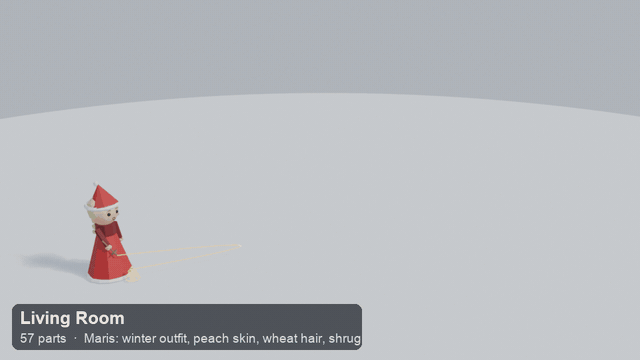

# Christmas street

The scene of the three demo videos: a street in the snow with houses, a cabin, a bus, a van, a snow
truck, people, a cat, a squirrel, a snowman, a play park, and one house you can look into.

Recordings of it being built and renders of the finished scene: [../gifs/](../gifs/README.md).



## How it was made

Row by row, through the Copilot add-on in Blender 5.2, on a laptop with a 4 GB GPU.
`prompts.jsonl` is the exact list of rows of the single take, in order: the model makes the
shapes, the copilot's code places, colours and groups them.

| | single take (`prompts.jsonl`) | batched take (`prompts-batched.jsonl`) |
|---|---|---|
| rows | 918 | 733 |
| rows the **model** answers (`"prompt"`): one primitive with its numbers, sent as Build | 204 | 73 (several parts in one prompt) |
| rows the **recording driver** runs by code (`"direct"`) | 714 | 660 |

What the `direct` rows do, in the single take: 259 set a material, 237 check one part and put it
where the prompt said if the model missed, 123 are tool calls the driver writes itself (more
shapes, for example the fireplace, and modifiers), 47 parent the parts of a thing under one name,
15 copy a finished thing along the street, and the rest add the roof gables, the lights, the
glow, the snow, two animations and the camera. The model's share is the 204 shapes it was asked
for; placing them exactly, colouring them, grouping them and everything else is code.

The driver that types the rows into the panel and records the screen is a maintainers' tool and is
not in this repository. Any `prompt` row can be pasted into the panel (switch on **Build**) to see
what the model does with it.

## Files

| file | what |
|---|---|
| `prompts.jsonl`, `prompts-batched.jsonl` | the rows of the two takes |
| `scene.blend` | the finished scene of the single take, as Blender saved it |
| `scene.glb`, `scene.fbx` | the same scene for other programs. The FBX holds every grass and snow instance as its own object and is large |
| `objects/<Name>.glb`, `objects/<Name>.fbx` | one file per built thing, moved to the origin: 31 things |
| `objects.json` | name, number of parts and size in metres of each thing |

Copies of a thing along the street (`House.001` ...) are in the scene files and are not exported
again one by one. Every file here was opened once in Blender after the export
(`demo/tools/check_files.py`).

## Make the exports again

```sh
blender -b demo/christmas-street/scene.blend --python demo/tools/export_scene.py -- demo/christmas-street
blender -b --factory-startup --python demo/tools/check_files.py -- demo/christmas-street
```
