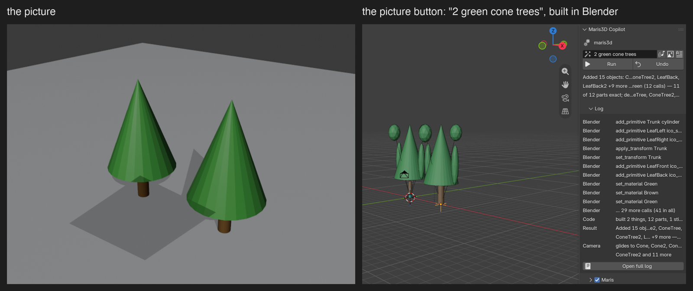

# Maris3D 0.3.0: picture input, voice in many languages

Maris3D is a small Blender copilot that runs offline: a 0.5B model plus a Python app and a Blender add-on. You type,
say or now show what you want; the model answers in plain words; the app's compiler turns the words into Blender tool
calls and builds the scene. 0.3.0 is a new app on the same model files as 0.2.2: re-run the one-line install, and
there is nothing new to download for the model.

## What is new

- **Picture input (optional).** Press the picture button next to the prompt and pick a PNG, JPG, WEBP or BMP. A small
  vision model (SmolVLM-500M-Instruct, about 550 MB, downloaded from Hugging Face and sha256-checked, not part of the
  package) is asked a few short questions on your machine: what it is, which objects are in it, the main colour. It closes
  after each one. The answers become a short request such as "a red ball" or "5 brown chairs", which runs like a typed
  prompt, after anything you typed. If the machine has no room for both models, the copilot's own server is stopped
  for those seconds and started again, so nothing swaps. MCP hosts: `scene_request` takes an optional `image` path.
  Set it up with `maris3d install --vision`.
- **Voice in many languages.** Voice input uses an English-only speech model by default (best for English), or a
  many-language one of the same size (60 MB) that detects the language as you speak: the interactive install asks, or
  `maris3d install --voice --voice-lang multi`. The model itself is trained on English requests: in a small test,
  simple requests in Spanish, French, German and Chinese were built right 8 times in 12 (see the
  [FAQ](FAQ.md)).
- **The one-line installers ask nothing**: running them is the yes. They set up the add-on, the model, voice and
  picture input, put `maris3d` on your PATH and start the local server. `MARIS3D_ASK=1` asks before each step;
  `MARIS3D_NO_MODIFY_PATH=1` leaves your shell files alone.
- **Maris keeps moving** after an error in one of her moves; that one move is dropped.

## The numbers

SLM4Apps SceneBench 1.0: 4,269 items in 10 areas, each with a gold answer, scored by outcome through the app's own code.

| Area (items) | 0.3.0 |
|---|---|
| Make one thing (1,212) | 72.2 |
| Lay out a scene (1,031) | 29.6 |
| Place exactly (204): built exactly through the app | 99.5 |
| Change what is there (841) | 65.4 |
| Camera, light, text, finish (377) | 96.6 |
| Make it move (30) | 43.3 |
| Blender tools (108) | 21.5 |
| Talk (344) | 96.4 |
| Picture to scene (24 reference pictures): thing, count and colour right | 66.7 |
| **Overall** (mean of 9 areas) | **65.7** |

The 51-request demo replay through the 0.3.0 app in Blender: 0 failed requests. Every area side by side with 0.2.1,
and the held-out sets of 0.2: [BENCHMARKS.md](BENCHMARKS.md).

## What it cannot do

The limits of 0.2 still hold; see [release-v0.2.md](release-v0.2.md) and
[SAFETY-AND-LIMITATIONS.md](SAFETY-AND-LIMITATIONS.md). Picture input works best on a picture of one kind of thing;
it does not copy a whole scene or its layout.

## How to run it

Install in one command (no clone needed):

- macOS / Linux: `curl -fsSL https://raw.githubusercontent.com/slm4apps/maris3d/main/install.sh | sh`
- Windows (PowerShell): `powershell -ExecutionPolicy ByPass -c "irm https://raw.githubusercontent.com/slm4apps/maris3d/main/install.ps1 | iex"`

Already on 0.2.x? Re-run the one-line install (or `pip install -U git+https://github.com/slm4apps/maris3d`) for the
0.3.0 app; for picture input on an existing install, `maris3d install --vision`. Then open the sidebar tab
**Maris3D Copilot** in Blender's 3D View: type a sentence and press **Run**, press the mic button and say it, or press
the picture button and pick a picture. Weights: [slm4apps/Maris3D-Blender](https://huggingface.co/slm4apps/Maris3D-Blender).
Details: [USAGE.md](USAGE.md).

0.2.2 stays at the GitHub tag `v0.2.2` and the `v0.2.2` revision of the Hugging Face repository ([release-v0.2.2.md](release-v0.2.2.md));
0.1 at the GitHub tag `v0.1.2` and the `v0.1.0` revision ([release-v0.1.md](release-v0.1.md)).

## How you can help

Use it on real work and report where it breaks: send the sentence (or the picture), what you expected and what the
panel said. Failures from real work are worth more than another benchmark number.

Everything ships under Apache-2.0: code and weights (the Qwen base is Apache-2.0), docs included. The Blender add-on
files that import `bpy` are GPL-3.0-or-later, because Blender's API is GPL. SmolVLM-500M-Instruct and the whisper.cpp
speech models are downloaded from their own Hugging Face repositories under their own licences (see NOTICE).
