# Maris3D SLM Blender 0.5B (v0.3.0)

*A 0.5B model that builds Blender scenes from plain words, offline.*

[](https://github.com/slm4apps/maris3d)
[](https://github.com/slm4apps/maris3d/releases)
[](https://github.com/slm4apps/maris3d/blob/main/LICENSE)
[](https://www.blender.org)

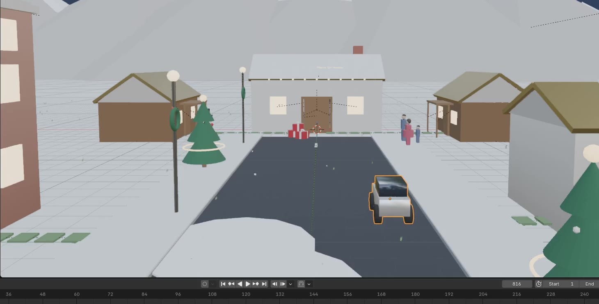

## Install in one command

No need to clone anything. This installs the Blender add-on, downloads the two model files below
(sha256-checked) and tests them in your Blender. Needs Python 3.9+ and Blender 4.2+.

| macOS / Linux | Windows (PowerShell) |
|---|---|
| `curl -fsSL https://raw.githubusercontent.com/slm4apps/maris3d/main/install.sh \| sh` | `powershell -ExecutionPolicy ByPass -c "irm https://raw.githubusercontent.com/slm4apps/maris3d/main/install.ps1 \| iex"` |

Then: `maris3d serve start`, open Blender, press `N` in the 3D View, pick the **Maris3D Copilot**
tab, type a sentence and press **Run**. Try:

| Build one thing | Build a whole scene | Change what is there |
|---|---|---|
| `a small house` | `a park with a bench, a tree behind the bench and a lamp next to the bench` | `Make the bench blue.` then `Move the lamp to the left of the bench.` |

You describe a scene in a sentence. The model answers in plain words: which things, how many, what
they are made of and where they stand. The Maris3D app turns those words into exact Blender
tool calls, builds the scene, reads it back and checks it. The model never writes a number; code
computes every size and position.

It runs fully offline on your own machine: one 531 MB base file plus a 23 MB adapter, on a
4-core laptop CPU at 28.5 tok/s in 876 MB of memory (measured with the 0.2.0 adapter).

On held-out sets it plans the right things **97.3 %** of the time (2,951 of 3,033 things in 716
sentences), designs a new thing's parts that pass the app's rules **99.0 %** (1,268 names), answers
talk right **96.1 %** (152 turns) and invents nothing in 383 turns. The app builds **203 of the 204**
exact adds of the 0.1 demo scene exactly (**99.5 %**).
Read the limits section before you use it.

**Uncensored by training.** The fine-tune leaves no refusal behavior: dark game-art requests (weapons,
gore, horror props, standard 3D art fare) are planned like anything else. 0 of 18 refused in our probe.

## Files

| File | What it is |
|---|---|
| `maris3d-slm-blender-0.5b-q8_0.gguf` | The base (531 MB): the 0.1 weights, with Maris3D metadata. |
| `maris3d-slm-blender-0.5b-v0.2.2-lora-f16.gguf` | The adapter (23 MB): plans, parts, word edits, talk. |
| `maris3d-slm-blender-tiny-0.02b-f16.gguf` | **Preview:** Maris3D SLM Blender Tiny 0.02B (50 MB), a whole model trained from scratch. See below. |
| `Modelfile` | The Ollama entry `maris3d-slm-blender-0.5b`, with the settings the app sends. |
| `MANIFEST.json`, `SHA256SUMS` | The current file of each role with its sha256, read by `maris3d update`. |

## Maris3D SLM Blender Tiny 0.02B (preview)

A second, much smaller model: **24.5 million parameters, one 50 MB file**, about twenty times smaller than
the 0.5B. It is not a cut-down copy of a bigger model. It was trained from scratch, first on Simple
English Wikipedia, then on the Maris3D task data, and it answers in the same word language as the 0.5B.

- Its own dictionary: 17,665 entries, 1,281 of them whole Blender words (sizes, places, colours,
  finishes), one entry each. A standard 0.5B dictionary at this width would need 58 M parameters alone.
- Llama architecture, 10 layers, width 384, context 2,048 tokens. One file, no adapter.
- Speed: about **590 tokens a second** writing on a laptop CPU (Apple M3, 4 threads, no GPU), 7,400 a
  second reading the prompt (`llama-bench`, this file).
- The file is a weight average of three checkpoints (steps 5,670, 7,560 and 15,192), picked by scoring
  every checkpoint on the job, not by held-out loss.

Same test sets as the 0.5B (150 rows a set), share done right:

| Set | Tiny 0.02B | Maris3D 0.5B (0.2.1) |
|---|---|---|
| Direct commands: camera, light, text, finish | **97.6 %** | 76.1 % |
| Object designs that pass every check | **52.0 %** | 31.3 % |

**Preview** means the file is out for people to try and measure; the Maris3D app picks it up in a
later release, and until then the installer keeps installing the 0.5B. Run it on its own with
llama.cpp:

```sh
llama-server -m maris3d-slm-blender-tiny-0.02b-f16.gguf --port 8080
```

The chat template inside the file maps the app's own system prompts to the jobs Tiny was trained on.
Limits: it cannot copy exact numbers (the app reads those from the request in code), whole-scene
plans and word edits are better on the 0.5B, its context is 2,048 tokens, and like the 0.5B it was not trained to refuse anything. Stage-one text: Simple English
Wikipedia (`wikimedia/wikipedia`, `20231101.simple`), CC BY-SA 3.0 and GFDL.

## What is new in 0.2

- **Words, not numbers.** 0.1 wrote tool calls with coordinates. 0.2 answers in one small word
  language (things, relations such as *behind* or *on top of*, sizes such as *half* or *double*),
  and the app's compiler writes the tool calls.
- **One adapter** for everything: planning, designing a new thing's parts, word edits and talk,
  instead of 0.1's separate edit and planner adapters.
- **Animation** by the app's code: "a ball bouncing twice", "a moon going round a planet".
- **Edits by words.** "Make the table darker", "move the lamp next to the sofa": the model
  says what changes, code applies it and checks it.
- **Talk.** Ask about the scene and it answers from what is there.
- Breaking change: 0.2 needs the 0.2 app. 0.1 stays available as
  [Maris3D-Blender v0.1.0](https://huggingface.co/slm4apps/Maris3D-Blender/tree/v0.1.0)
  and at tag `v0.1.2` on GitHub.
- **0.2.1:** The same weights as 0.2.0. The files now carry the Maris3D name and identity; `maris3d update` fetches both again (543 MB).
- **0.2.2:** A new adapter, trained further on edit and parts rows and blended from two of its checkpoints. It knows
  more change words: cameras, lights, texts, aim, attach, finishes (bevel, mirror, array, twist ...) and scene settings.
  Same base file; update the app (re-run the one-line install), then `maris3d update` fetches only the adapter (23 MB). The app reads exact adds ("Add a cube named Path
  at -1, 0, 0 with a scale of 0.4, 2.0, 0.01") by code, and adds voice input, undo and a livelier Maris.
- **0.3.0:** The same model files as 0.2.2; the app is new. Optional **picture input**: `maris3d install --vision`
  adds a small vision model (SmolVLM 500M, downloaded from Hugging Face, not part of these files); pick a picture and
  Maris3D builds from it. Voice input in English or, with `--voice-lang multi`, in many languages. On SLM4Apps SceneBench 1.0 (4,269 items in
  10 areas) 0.3.0 scores 65.7 overall; see Results.


## See it build

The finished demo street, rendered in Blender: a slow zoom into the hero house and its fireplace.

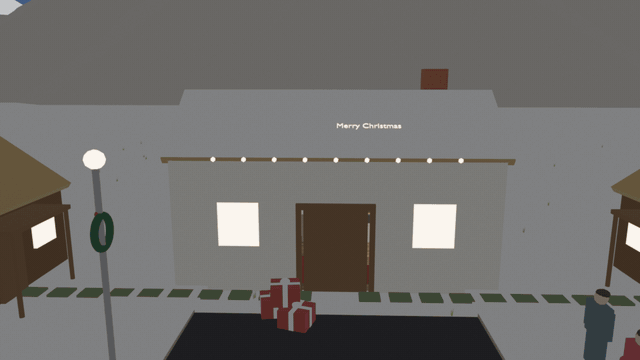

Screen recordings of the street being built (Blender 5.2, recorded with 0.1, sped up). Each thing is
one typed request. The 204 requests of these demo scenes, replayed through the 0.2.2 app:
**203 built exactly** (right thing, place and size).

| | |
|---|---|
|  | 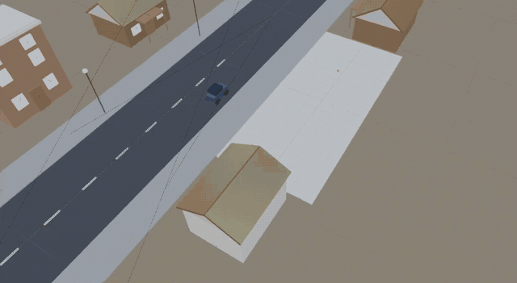 |
| 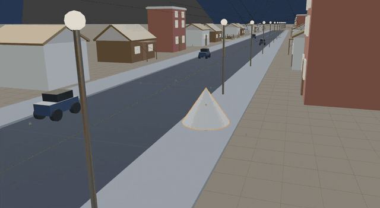 | More recordings and renders of every thing in the scene are in the [GitHub repository](https://github.com/slm4apps/maris3d/tree/main/demo/gifs). |

Maris is the add-on's mascot (optional): she weaves while the copilot builds and reacts when it
finishes. Here she stands beside groups of things from the demo street in a different outfit, skin,
hair and pose each time; every part appears in turn, then a 360 turn.

| | |
|---|---|
|  | 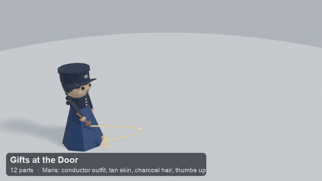 |
| 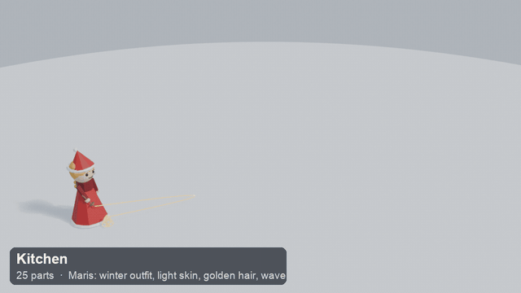 |  |
| 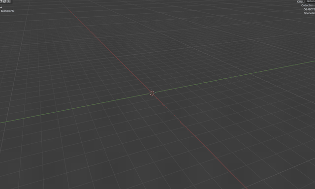 | 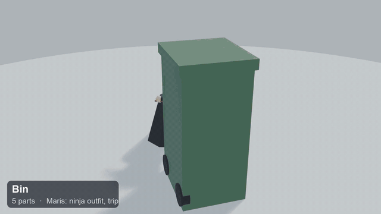 |

## Ways to run it

- **The Maris3D app (recommended).** `maris3d install` fetches the base and the adapter;
  `maris3d serve start` runs llama-server with them. `maris3d update` later fetches only the files
  that changed.
- **llama-server by hand:**
  `llama-server -m maris3d-slm-blender-0.5b-q8_0.gguf --lora maris3d-slm-blender-0.5b-v0.2.2-lora-f16.gguf --lora-init-without-apply --jinja -c 8192`
- **Ollama:** `ollama create maris3d-slm-blender-0.5b -f Modelfile` (that is `:latest`, the name the app uses;
  `ollama cp maris3d-slm-blender-0.5b maris3d-slm-blender-0.5b:0.3.0` keeps this version by name), then pick Ollama in the app's settings.

Serve with temperature 0, a context of 8,192 and repeat penalty 1.05 (the app sends these on every request).

## Results

### SLM4Apps SceneBench 1.0 (0.3.0)

One frozen set of 4,269 items in 10 areas, each with a gold answer, scored by outcome through the app's own code.
The strongest areas are below; the overall score is the mean of all 9 areas 0.3.0 has a result for.

| Area (items) | 0.3.0 |
|---|---|
| Make one thing (1,212) | 72.2 |
| Place exactly (204): built exactly through the app | 99.5 |
| Change what is there (841) | 65.4 |
| Camera, light, text, finish (377) | 96.6 |
| Talk (344) | 96.4 |
| Picture to scene (24 reference pictures): thing, count and colour right | 66.7 |
| **Overall** (mean of 9 areas) | **65.7** |

Every area, side by side with 0.2.1: [BENCHMARKS](https://github.com/slm4apps/maris3d/blob/main/docs/BENCHMARKS.md).

### Held-out sets

Sets the model never trained on, scored by outcome through the app's own code (0.2.2; edit rows use the prompt without the new change words, see BENCHMARKS section 2b for both).

| What | Result |
|---|---|
| Plan from one sentence: the things named are right | 97.3 % (2,951 of 3,033 things in 716 held-out sentences) |
| the relation (behind, next to, on top of ...) is right | 97.1 % |
| the thing it is placed by is right | 95.9 % |
| the whole sentence is planned right | 84.1 % (602 of 716) |
| Parts of a new thing: the answer parses | 99.9 % (1,268 held-out names) |
| the design passes the app's rules | 99.0 % |
| Word edits: the change asked for is the change made | 85.4 % (726 held-out change requests) |
| Talk: the reply is right | 96.1 % (152 held-out turns); 96.5 % (231 turns, a second set) |
| Talk: things invented that are not in the scene | 0 in 383 turns |
| Long sentences that join several groups of things: the whole plan exact (things, counts, places) | 40.0 % (60 held-out sentences) |
| The app's code, no model: the 0.1 demo scene, its 204 exact adds through the 0.2.2 app, built exactly (right thing, place and size) | 99.5 % (203 of 204) |

With the new change words in the prompt (150 held-out rows each): the whole sentence planned right
82.0 %, parts pass the app's rules 100 %, talk right 96.7 %.
Every set, side by side with 0.2.1: [BENCHMARKS](https://github.com/slm4apps/maris3d/blob/main/docs/BENCHMARKS.md).

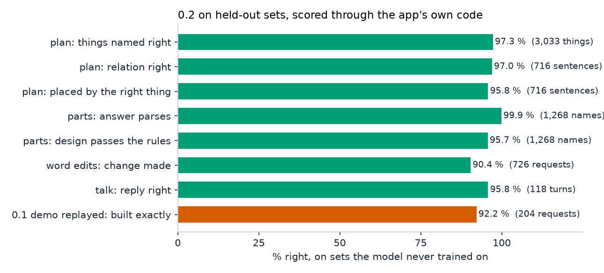

### The 180-request benchmark

Run on 0.2.0; not run again for 0.2.2.

Our internal suite of real requests across single objects, multi-part scenes, arrays and rings,
parenting, geometry nodes, animation and edits (the public benchmark is being prepared), with the
same frozen scorer for every model. pass % = fully correct; usable % = correct or correct with
small fixes. Every row is n=180: 150 build requests and 30 edit follow-ups. The other models' rows
are the ones measured for 0.1; the API and CLI arms ran on the providers' machines, the CLI arms
inside their own agent scaffolding, so read the table as tiers.

| Model | ran on | build pass / usable (n) | edit pass / usable (n) |
|---|---|---|---|
| claude-haiku-5.5 (CLI) | remote API | 52.7 / 89.3 (150) | 70.0 / 96.7 (30) |
| gpt-6-luna (CLI) | remote API | 46.7 / 78.0 (150) | 76.7 / 90.0 (30) |
| qwen3.8-27b (API) | remote API | 31.3 / 64.0 (150) | 73.3 / 93.3 (30) |
| **Maris3D 0.2** | 4-core laptop CPU | 24.7 / 80.7 (150) | 16.7 / 46.7 (30) |
| Maris3D 0.1 | 4-core CPU VM | 24.0 / 73.3 (150) | 43.3 / 86.7 (30) |
| deepseek-v4.1-flash (API) | remote API | 12.0 / 30.0 (150) | 43.3 / 66.7 (30) |
| qwen3.5-2b | 4-core CPU VM | 10.0 / 50.0 (150) | 23.3 / 46.7 (30) |
| qwen3.5-0.8b | laptop CPU | 4.7 / 50.7 (150) | 6.7 / 43.3 (30) |
| qwen3-0.6b | 4-core CPU VM | 2.0 / 14.7 (150) | 6.7 / 36.7 (30) |
| qwen3-1.7b | 4-core CPU VM | 1.3 / 6.0 (150) | 23.3 / 46.7 (30) |

Overall, 0.2 is 23.3 % pass / 75.0 % usable. The 0.1 rows are the 0.1 card's run (27.2 / 75.6); a later
0.1 run with the router picking the adapter per request gave 28.3 / 88.9 ([BENCHMARKS](https://github.com/slm4apps/maris3d/blob/main/docs/BENCHMARKS.md)). On the 150 build requests 0.2 gives
the most usable scenes of the local models (80.7 %, 0.1 73.3 %). Untrained small models (plain
Qwen2.5-Coder-0.5B, the 1.5B and 7B coders, Hammer2.1-0.5b, gemma-3-1b-it) score 0.0 on this
benchmark.


By mode, pass % / usable %; edit rows are follow-ups in a session:

| Model | single | multipart | arrays/rings | parenting | geonodes | animation | edit |
|---|---|---|---|---|---|---|---|
| claude-haiku-5.5 (CLI) | 52.5/97.5 | 30.0/80.0 | 90.0/100.0 | 55.6/72.2 | 91.7/100.0 | 33.3/86.7 | 70.0/96.7 |
| gpt-6-luna (CLI) | 37.5/75.0 | 46.7/90.0 | 70.0/80.0 | 66.7/77.8 | 50.0/66.7 | 30.0/73.3 | 76.7/90.0 |
| qwen3.8-27b (API) | 22.5/65.0 | 6.7/36.7 | 45.0/65.0 | 50.0/77.8 | 75.0/91.7 | 30.0/70.0 | 73.3/93.3 |
| **Maris3D 0.2** | 22.5/97.5 | 10.0/83.3 | 40.0/70.0 | 5.6/66.7 | 0.0/50.0 | 53.3/83.3 | 16.7/46.7 |
| Maris3D 0.1 | 10.0/70.0 | 13.3/76.7 | 40.0/60.0 | 22.2/77.8 | 83.3/83.3 | 20.0/76.7 | 43.3/86.7 |
| deepseek-v4.1-flash (API) | 7.5/30.0 | 0.0/13.3 | 15.0/20.0 | 27.8/38.9 | 33.3/66.7 | 10.0/33.3 | 43.3/66.7 |
| qwen3.5-2b | 2.5/40.0 | 6.7/46.7 | 25.0/25.0 | 27.8/72.2 | 16.7/25.0 | 0.0/80.0 | 23.3/46.7 |
| qwen3.5-0.8b | 5.0/60.0 | 0.0/60.0 | 15.0/40.0 | 11.1/66.7 | 0.0/16.7 | 0.0/40.0 | 6.7/43.3 |
| qwen3-0.6b | 5.0/42.5 | 0.0/0.0 | 0.0/0.0 | 5.6/11.1 | 0.0/8.3 | 0.0/6.7 | 6.7/36.7 |
| qwen3-1.7b | 2.5/10.0 | 0.0/0.0 | 0.0/5.0 | 0.0/0.0 | 0.0/0.0 | 3.3/13.3 | 23.3/46.7 |


### Public benchmarks (measured on 0.1)

0.1 ran 3DCodeBench (212 of 212 scenes) and BFCL v4 simple, python (49.25 %). Both score a model
that writes tool calls itself; in 0.2 the app's compiler writes the calls, so they were not run
again.

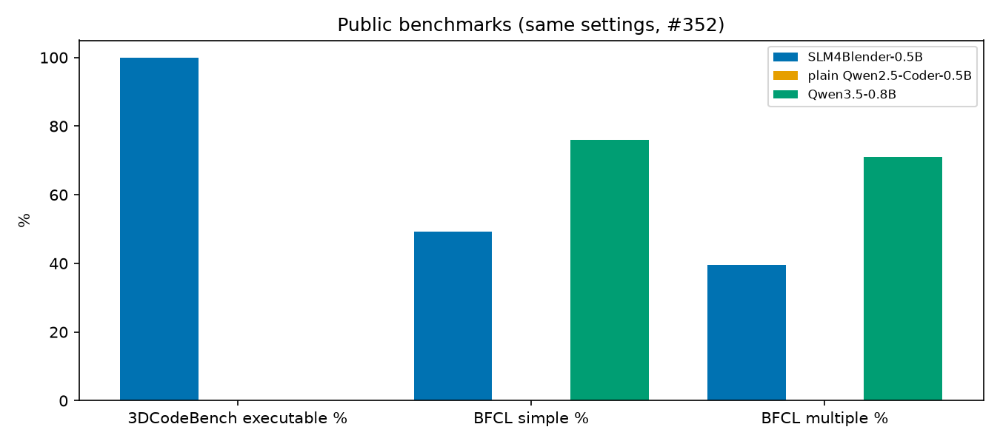

## Speed (measured with the 0.2.0 adapter)

Base + adapter in llama-server, as the app serves it, on CPU only:

| ran on | generation | prompt reading | memory |
|---|---|---|---|
| 4-core Intel laptop CPU (i7-6700HQ), 4 threads | 28.5 tok/s | 142 tok/s | 876 MB |

Measured with a 555-token prompt and 128 generated tokens, three runs (28.2 to 28.8 tok/s). One
benchmark request, from the sentence to a checked scene in Blender, takes 16.0 s (median of 180)
on that CPU.

The base file is the one 0.1 shipped. Measured for 0.1, the base alone runs at 96.7 tok/s on an
Apple-silicon Mac (Metal), 141.5 tok/s on a laptop with a 4 GB GTX 980M, and 62.1 tok/s on a
4-core CPU VM:

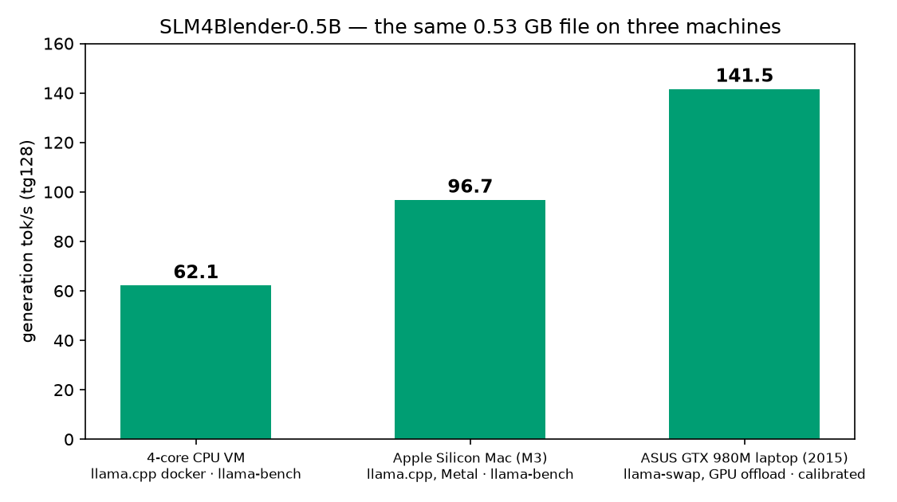


## Training

Base: Qwen2.5-Coder-0.5B-Instruct (Apache-2.0). The adapter is a LoRA trained on text-only
conversations in the word language.

## Limits

- No lights, cameras or text from a plain request yet; an animation that names a camera or a light
  ("a camera circling the cube") gets a real one from the app's animation code, and from 0.2.2 a
  change to a built scene can add a camera, a light or a text.
- It writes the word language; the Maris3D app's compiler turns that into Blender tool calls.
- Edit follow-ups on the 180-request benchmark: 46.7 % usable (0.1: 86.7 %).
- Where it is weaker, mode by mode:

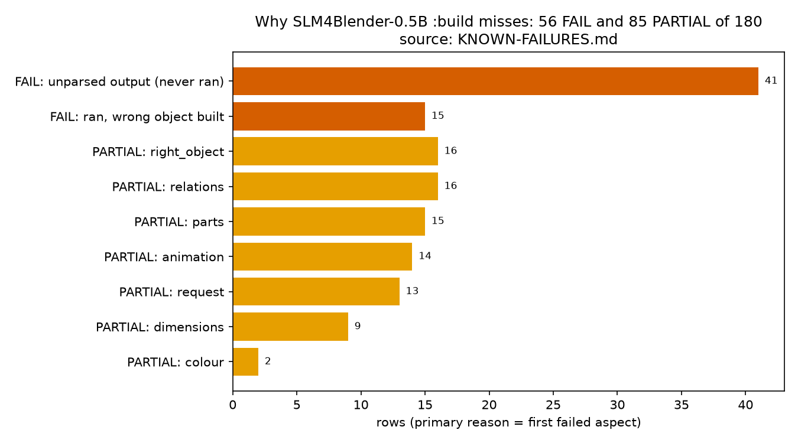

## Support the project

Maris3D is built and trained by one person on home machines. If it is useful to you, you can support the next versions on [Ko-fi](https://ko-fi.com/zinoadidi) or [Buy Me a Coffee](https://buymeacoffee.com/zinoadidi). Videos of Maris3D building scenes are on [YouTube](https://www.youtube.com/@SLMForApps).

## Licence

Apache-2.0 for the weights and code (see `LICENSE` and `NOTICE`). The Blender add-on, which runs
inside Blender, is GPL-3.0-or-later. Base model Qwen2.5-Coder-0.5B-Instruct is Apache-2.0
(Alibaba Qwen team). This project is not affiliated with, endorsed by, or supported by the Blender
Foundation. "Blender" is a trademark of the Blender Foundation.
