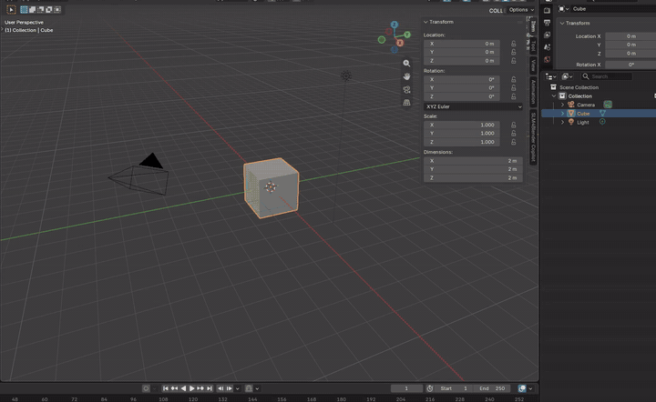
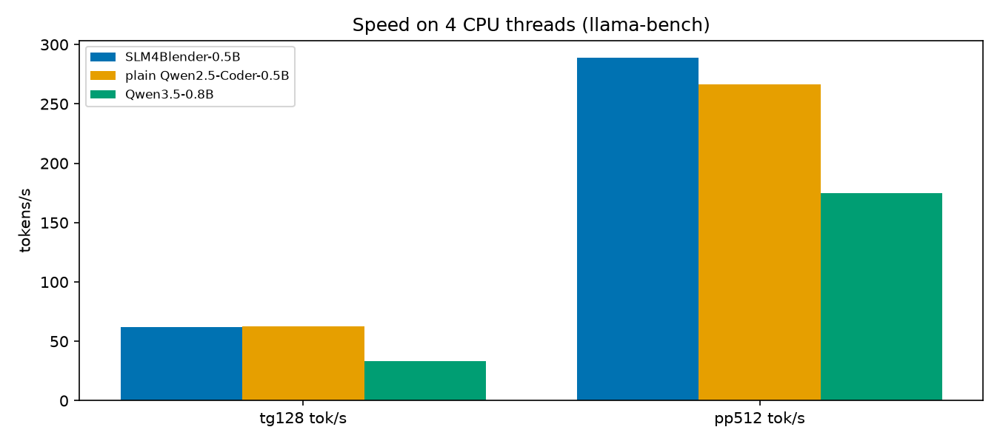
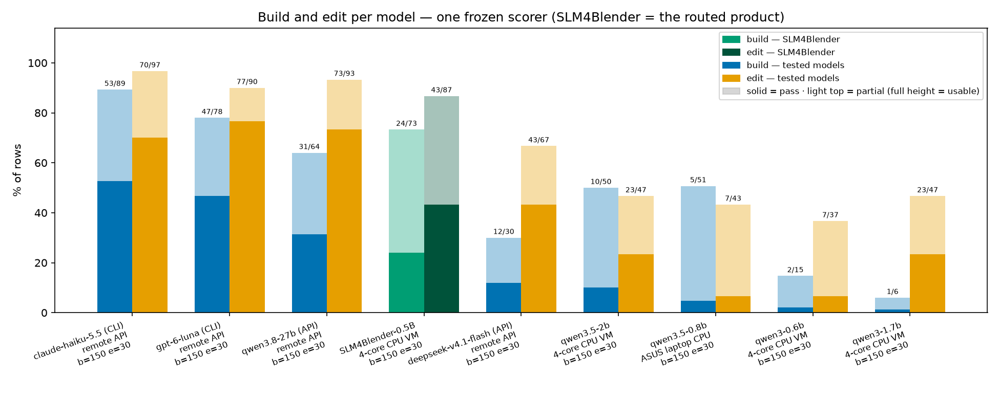
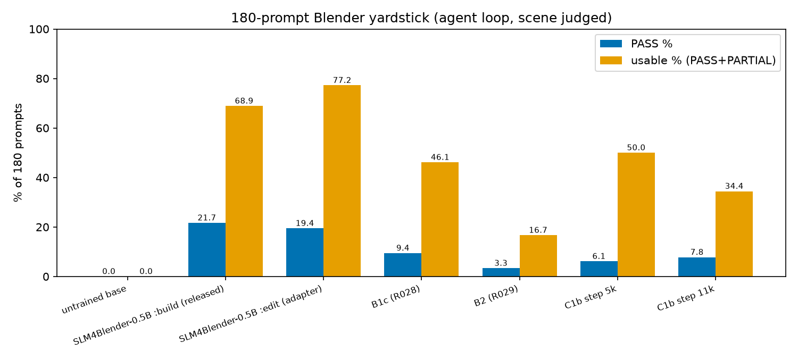
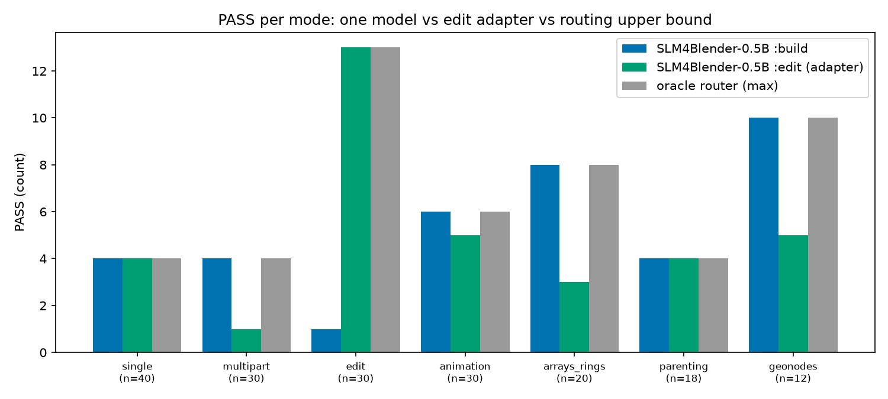
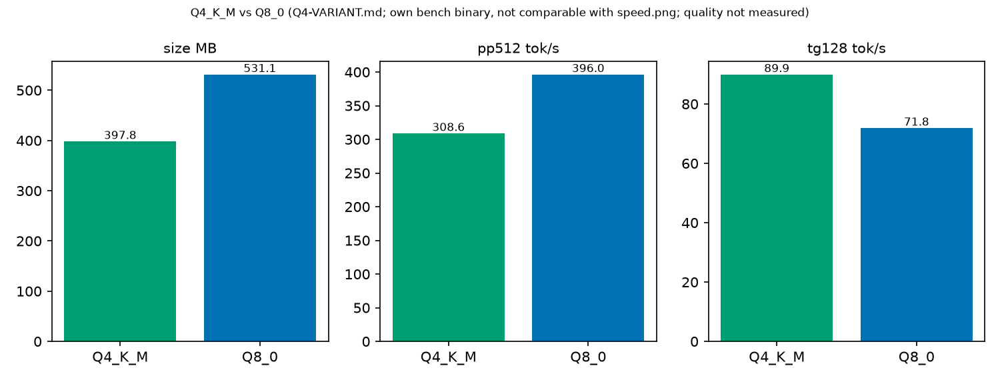
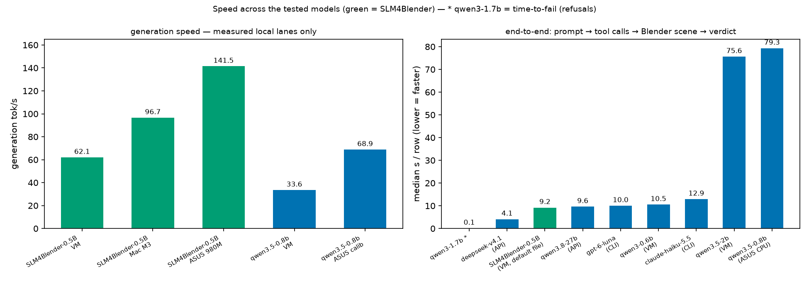

# Maris3D-SLM-Blender-0.5B (v0.1 preview)

*A 0.5B model that speaks Blender tool calls natively.*

## Install in one command

No need to clone anything. This installs the Blender add-on, downloads the three files below
(sha256-checked) and tests them in your Blender. Needs Python 3.9+ and Blender 4.2+.

| macOS / Linux | Windows (PowerShell) |
|---|---|
| `curl -fsSL https://raw.githubusercontent.com/slm4apps/maris3d/main/install.sh \| sh` | `powershell -ExecutionPolicy ByPass -c "irm https://raw.githubusercontent.com/slm4apps/maris3d/main/install.ps1 \| iex"` |

Then: `maris3d serve start`, open Blender, press `N` in the 3D View, pick the **Maris3D Copilot**
tab, type a sentence and press **Run**. Try:

| Build one thing | Build a whole scene | Change what is there |
|---|---|---|
| `a small house` | `a park with a bench, a tree behind the bench and a lamp next to the bench` | `Make the bench blue.` then `Move the lamp to the left of the bench.` |

Already run Ollama, llama-server or LM Studio? See `SERVE.md` and "Ways to run it" below.

It **builds and edits Blender scenes by calling tools**, fully offline on ordinary
machines — an 8 GB Mac (about 0.6 s per answer, 1.3 s cold load), a 2015 laptop with a
4 GB GPU (its fastest lane: 141.5 tok/s), or a 4-core CPU VM (62 tok/s) — always 0.58 GB
of memory.

With its **planner adapter**, one sentence that names several things and where they stand
("a platform, a station building behind the platform, a train on top of the track") becomes a
scene: the planner writes the plan in words, code computes every number, the model makes the
parts and a check corrects them. It knows 40 everyday things by name.

Asked for one shape at a time, **76% of requests produce a usable scene** — fully correct or
needing at most small corrections — and **27% land fully correct on the first try**. Read
the limits section before you use it.

**Uncensored by training.** The fine-tune leaves no refusal behavior: every prompt is
answered with tool calls, and dark game-art requests (weapons, gore, horror props — standard
3D art fare) build the same as anything else — 0 of 18 refused in our probe. The model only
emits its 26 Blender tool calls (the planner adapter: one JSON plan); it does not generate text.

Output is the standard Qwen tool-call format (`{"name": ..., "arguments": ...}`), so any host
that speaks Qwen tools can drive it — for example `llama-server --jinja` (see `SERVE.md`).
It was trained on a fixed set of 26 Blender tools; with other tool sets it does not work well.
Context: trained on rows up to 2,048 tokens. Serve it with 8,192 — the 26-tool manifest
plus a conversation can overflow 4,096. Keep temperature 0 and repeat penalty 1.0: a tool
call is repetition by design, and a penalty of 1.1 (Ollama's default) makes the model drop
object names and can loop one call to the token limit. The repo's `params` and `system`
files carry these settings for an Ollama pull; details in `SERVE.md`.

## Files
| File | What it is |
|---|---|
| `maris3d-slm-blender-0.5b-q8_0.gguf` | **The base** (506 MB) — served with the adapter below. The strongest build behaviour of any file (24.0 vs 14.7 with the merged edit file). |
| `maris3d-slm-blender-0.5b-edit-lora-f16.gguf` | **The edit adapter** (5.6 MB) — loaded beside the base: fresh prompts run it at scale 0, corrections at 1.0. Together they are the release. |
| `maris3d-slm-blender-0.5b-planner-v31-lora-f16.gguf` | **The planner adapter** (5.6 MB) — loaded beside the base and the edit adapter; it turns one sentence ("a station building behind the platform") into a plan in words. It runs alone, on a plan turn only. |
| `MANIFEST.json` | The current file of each role (base, edit, planner) with its sha256: what `maris3d update` reads. |
| `maris3d-slm-blender-0.5b-edit-q8_0.gguf` | Merged single-file alternative for hosts without adapter support (19.4 / 77.2). Same edit weights, no switch. |
| `maris3d-slm-blender-0.5b-q4_k_m.gguf` | Smaller build-only file (25% smaller, some quality loss). |

## Plan first: one sentence builds a scene
With the planner adapter on the server, the add-on's **Auto** and the MCP tool `build_scene` plan
first. The planner names the things and says where they stand, in words only; code turns the
words into exact instructions (a built-in table holds the parts of 40 everyday things: bench,
tree, house, train, lamp post ...); the edit adapter makes each part; a check reads every part
back from Blender and corrects it; the panel says how many parts were exact and how many corrected.

Measured (each number with what it measures):

| what | result |
|---|---|
| Planner, 300 held-out sentences: the answer parses | 297 / 300 |
| the stated relation (behind, next to, on top of ...) is right | 98.6 % |
| the listed things are right | 96.3 % |
| the thing it is placed by is right | 87.3 %; 98.5 % on sentences whose names were all trained |
| the name of the thing is right | 83.7 % (three held-out names are written wrong) |
| Edit adapter copies one compiled part exactly (448 parts) | 283 / 448 (63.2 %); the check corrects the rest |

The 180-request scores below are for single requests to the model, without the planner. Words, sentences that were run and limits: `docs/PROMPTING-GUIDE.md` section 0 in
the code repository.

## Ways to run it
- **Recommended — 506 MB of base plus a 5.6 MB adapter, switched per request:**
  `maris3d install` fetches the base, the edit adapter and the planner adapter (518 MB),
  `maris3d serve start` runs one server with both adapters loaded; `maris3d update`
  later fetches a new adapter without a new download of the base. A fresh prompt goes out with the adapter
  at scale 0 (build weights); a correction goes out with it at 1.0 (edit weights). One
  process, one port, 518 MB — no reload, no waiting, nothing to configure — and the Auto /
  Build / Edit switch overrides the choice when you want. The row below was measured on
  these files, and the adapter reproduces it: all 29 edit rows scored identically to the
  merged edit file, build within run-to-run noise — 24.0 build / 43.3 edit, 27.2 pass /
  75.6 usable overall.
- **Simplest (no adapter):** serve `maris3d-slm-blender-0.5b-edit-q8_0.gguf` for everything —
  one file builds and edits with no adapter support, 19.4 pass / 77.2 usable overall.
- **Strict-pass:** serve `maris3d-slm-blender-0.5b-q8_0.gguf` with the LoRA at scale 0.7
  (`--lora maris3d-slm-blender-0.5b-edit-lora-f16.gguf --lora-scaled 0.7`): fewer fully-correct
  regressions than full scale, at the cost of some usable-scene percentage.

## Results
Maris3D-SLM-Blender-0.5B against the other models we ran through the same frozen scorer and agent
loop. Every model is one entry with a **build column and an edit column**: Maris3D-SLM-Blender-0.5B ships as
one base file plus the edit adapter — fresh prompts run it at adapter scale 0, corrections
at 1.0. The build column is the base's measured row; the edit column is the adapter at 1.0
(identical verdicts to the merged edit file on every edit row). Totals: pass 49/180 (27.2%),
usable 136/180 (75.6%). The single-file options (merged edit 19.4/77.2, strict 23.9/68.9,
base 21.7/68.9) with their trade-offs stay in the variant table further down.
`ran on` is the hardware lane — the point of the comparison: the API arms run on the
providers' datacenter machines, Maris3D-SLM-Blender-0.5B ran on a 4-core CPU VM, the GTX 980M arms on a
gaming laptop with a 4 GB GPU. `n` marks the sample: every row here is n=180. The CLI arms (claude / opencode) wrap the identical
messages in their own agent scaffolding, so they compare transports, not pure models —
read the table as tiers.

| Model | ran on | build pass / usable (n) | edit pass / usable (n) |
|---|---|---|---|
| claude-haiku-5.5 (CLI) | remote API | 52.7 / 89.3 (150) | 70.0 / 96.7 (30) |
| gpt-6-luna (CLI) | remote API | 46.7 / 78.0 (150) | 76.7 / 90.0 (30) |
| qwen3.8-27b (API) | remote API | 31.3 / 64.0 (150) | 73.3 / 93.3 (30) |
| **Maris3D-SLM-Blender-0.5B** | 4-core CPU VM | 24.0 / 73.3 (150) | 43.3 / 86.7 (30) |
| deepseek-v4.1-flash (API) | remote API | 12.0 / 30.0 (150) | 43.3 / 66.7 (30) |
| qwen3.5-2b | 4-core CPU VM | 10.0 / 50.0 (150) | 23.3 / 46.7 (30) |
| qwen3.5-0.8b | laptop CPU | 4.7 / 50.7 (150) | 6.7 / 43.3 (30) |
| qwen3-0.6b | 4-core CPU VM | 2.0 / 14.7 (150) | 6.7 / 36.7 (30) |
| qwen3-1.7b | 4-core CPU VM | 1.3 / 6.0 (150) | 23.3 / 46.7 (30) |

Ordered by build pass rate. On usable %, Maris3D-SLM-Blender-0.5B is **third of the nine models shown** (75.6
overall; haiku 90.6, luna 80.0 above) and ahead of qwen3.8-27b (68.9), and every model
below it is poorer on both metrics. qwen3.5-2b, qwen3-0.6b and qwen3-1.7b ran on the
**same 4-core CPU VM as Maris3D-SLM-Blender-0.5B** — same llama.cpp server, same frozen protocol.

Also tested, scored **0.0 / 0.0** — no valid tool calls on our 26-tool format without
training; off-the-shelf function-calling does not transfer: qwen2.5-coder-7b (GTX 980M,
n=180), qwen2.5-coder-1.5b (laptop CPU, n=180 — the same 0.0 floor on the VM in q4_k_m),
plain Qwen2.5-Coder-0.5B (VM q4_k_m n=180 **and** q8 n=180 — model-inherent, not a
quantisation effect), the untuned base of this very model (VM, n=180), Hammer2.1-0.5b
(VM, n=180), gemma-3-1b-it (VM, n=180), and qwen3.5-0.8b via Ollama on an Apple
Silicon Mac —
n=14, 0.0 pass / 78.6 usable, cancelled early, no per-bucket scores so it can't be split
into build/edit (the 0.8b row above is the same model's full 180-row laptop CPU run).

Per-bucket breakdown — pass % / usable % per mode; `(n)` marks a smaller-than-standard
bucket sample (strat30 arms); edit rows are multi-turn follow-ups in a session:

| Model | single | multipart | arrays/rings | parenting | geonodes | animation | edit |
|---|---|---|---|---|---|---|---|
| claude-haiku-5.5 (CLI) | 52.5/97.5 | 30.0/80.0 | 90.0/100.0 | 55.6/72.2 | 91.7/100.0 | 33.3/86.7 | 70.0/96.7 |
| gpt-6-luna (CLI) | 37.5/75.0 | 46.7/90.0 | 70.0/80.0 | 66.7/77.8 | 50.0/66.7 | 30.0/73.3 | 76.7/90.0 |
| qwen3.8-27b (API) | 22.5/65.0 | 6.7/36.7 | 45.0/65.0 | 50.0/77.8 | 75.0/91.7 | 30.0/70.0 | 73.3/93.3 |
| **Maris3D-SLM-Blender-0.5B** | 10.0/70.0 | 13.3/76.7 | 40.0/60.0 | 22.2/77.8 | 83.3/83.3 | 20.0/76.7 | 43.3/86.7 |
| deepseek-v4.1-flash (API) | 7.5/30.0 | 0.0/13.3 | 15.0/20.0 | 27.8/38.9 | 33.3/66.7 | 10.0/33.3 | 43.3/66.7 |
| qwen3.5-2b | 2.5/40.0 | 6.7/46.7 | 25.0/25.0 | 27.8/72.2 | 16.7/25.0 | 0.0/80.0 | 23.3/46.7 |
| qwen3.5-0.8b | 5.0/60.0 | 0.0/60.0 | 15.0/40.0 | 11.1/66.7 | 0.0/16.7 | 0.0/40.0 | 6.7/43.3 |
| qwen3-0.6b | 5.0/42.5 | 0.0/0.0 | 0.0/0.0 | 5.6/11.1 | 0.0/8.3 | 0.0/6.7 | 6.7/36.7 |
| qwen3-1.7b | 2.5/10.0 | 0.0/0.0 | 0.0/5.0 | 0.0/0.0 | 0.0/0.0 | 3.3/13.3 | 23.3/46.7 |

The variant history — the single-file options you can download. These are separate
configurations measured on earlier file revisions, not one "q4 is better" claim: **q4_k_m
alone is 18.3 / 67.2**; the 79.4 row is q4 **with the edit LoRA**. The shipped default is the base
file plus the adapter described above.

Maris3D 180-request benchmark (our internal suite of real requests across single-object,
animation, arrays/rings, parenting, geometry nodes, edit and multi-part scenes; the public
benchmark is being prepared). pass % = fully correct; usable % = correct or correct-with-small-fixes.

| Variant | pass % | usable % | edit requests usable (of 30) | build requests usable (of 120) |
|---|---|---|---|---|
| merged single file (fallback): edit merged, q8_0 | 19.4 | 77.2 | 26 | 94 (78.3%) |
| strict: base + LoRA @0.7 | 23.9 | 68.9 | 24 | 82 (68.3%) |
| base alone, q8_0 | 21.7 | 68.9 | 14 | 87 (72.5%) |
| q4_k_m + edit LoRA @1.0 (not q4 alone — see note) | 20.0 | 79.4 | 26 | 96 (80.0%) |

External: 3DCodeBench 212/212 scenes run; BFCL v4 simple (python) 49.25%.

## Speed

The same 0.53 GB file on three machines:

| ran on | serving | generation speed |
|---|---|---|
| Apple Silicon Mac (M3, Metal) | llama.cpp, Metal backend | 96.7 tok/s tg128 / 2747.7 tok/s pp512 (llama-bench) |
| GTX 980M laptop | llama-swap, layers offloaded to the 4 GB GPU | 141.5 tok/s generation (calibrated) |
| 4-core CPU VM | llama.cpp in docker | 62.1 tok/s tg128 / 289.1 tok/s pp512 (llama-bench) |

The 2015 gaming laptop is the fastest lane for this model — the 980M offload beats even
the M3 Mac (96.7) and the 4-core VM (62.1). Live end-to-end on the Mac panel: 0.9–2.1 s
per build prompt (2 tool calls each). `speed.png` above charts the VM llama-bench run.

Every model from the results table, on its own lane — generation speed where we could
measure tokens, plus the median wall-clock per benchmark row (prompt → tool calls →
Blender scene → verdict) for every arm with per-row timing:

| Model | ran on | gen tok/s (measured) | median s / row |
|---|---|---|---|
| claude-haiku-5.5 (CLI) | remote API | — | 12.9 |
| gpt-6-luna (CLI) | remote API | — | 10.0 |
| qwen3.8-27b (API) | remote API | — | 9.6 |
| **Maris3D-SLM-Blender-0.5B** | 4-core CPU VM | 62.1 (VM) · 96.7 (Mac) · 141.5 (laptop GPU) | 9.2 |
| deepseek-v4.1-flash (API) | remote API | — | 4.1 |
| qwen3.5-2b | 4-core CPU VM | — | 75.6 |
| qwen3.5-0.8b | laptop CPU | 33.6 (VM tg128) · 49.0 / 68.9 (laptop, two calib runs) | 79.3 |
| qwen3-0.6b | 4-core CPU VM | — | 10.5 |
| qwen3-1.7b | 4-core CPU VM | — | 0.1 |

Read the two columns differently. `gen tok/s` is pure model speed on that machine.
`s / row` is end-to-end request time on the arm's own lane — API/CLI arms include
provider latency and their scaffolding, local arms include Blender execution — so it
answers "how long until my scene exists", not "which model generates faster". For rows
that never parse it is time-to-fail, not throughput (qwen3-1.7b refuses instantly — 0.1 s
median). The zero-scoring floors from the footnote above were also timed: qwen2.5-coder-7b
generates at 8.8 tok/s on the 980M and still fails (34.0 s/row), qwen2.5-coder-1.5b runs at
71.1 tok/s and fails fast (7.6 s), gemma-3-1b spends 24.6 s emitting text that never
parses, and the untuned base of this model generates at 62.8 tok/s where Maris3D-SLM-Blender-0.5B runs 62.1 —
same base architecture, the fine-tune costs no speed. Maris3D-SLM-Blender-0.5B's own end-to-end: **9.2 s per
row** (VM) — inside the API arms' range (deepseek 4.1, 27b 9.6, luna 10.0, haiku 12.9)
and ~8× faster than the same-class stock qwen3.5-2b (75.6 s) on the same VM.

## Training
Base: Qwen2.5-Coder-0.5B-Instruct (Apache-2.0). Two LoRA stages, both rank 8:
a build LoRA (7 linear layers plus embeddings, merged into the weights), then an
edit LoRA (7 linear layers, layers 8-23; shipped as the separate adapter, and merged into
the single-file fallback). Training data
is text-only conversations with tool calls; no images, no code from Blender itself.
The planner is a third LoRA (rank 8, trained on a laptop GPU with 4 GB), kept apart from the
other two: 4,000 rule-made sentences, each answered with a list of things and their places in
words; scored on 300 sentences held out by phrasing and by name (table above).

## Limits
- Version 0.1: multi-part scenes asked without the planner and long requests are the weakest modes.
- Multi-turn steering is weak: in a conversation where you correct the model, it often stops
  acting after your first follow-up. Single-turn requests work best.
- It knows the 26 tools it was trained on. Other tools → it will guess.
- Plan first knows 40 things by name and does not design a thing it has never seen. A name the
  planner did not train on is often written wrong; the request then goes to the model alone.
  A change to the scene (recolour, resize) is not read back and checked in v0.1.
- It is a builder, not a chat assistant: without the `tools` array in the request it replies
  with canned text; always send the tools payload (see `SERVE.md`).
- Quantisation trades quality: the q4_k_m file is smaller but measurably worse.

## Support the project

Maris3D is built and trained by one person on home machines. If it is useful to you, you can support the next versions on [Ko-fi](https://ko-fi.com/zinoadidi) or [Buy Me a Coffee](https://buymeacoffee.com/zinoadidi).

## Licence
Apache-2.0 (code and weights, see `LICENSE` and `NOTICE`). The Blender add-on zip
(`maris3d_copilot-0.1.0.zip`) is **GPL-3.0-or-later** — it runs inside Blender. Base
model Qwen2.5-Coder-0.5B-Instruct is Apache-2.0 (Alibaba Qwen team). This project is not affiliated with, endorsed by, or supported
by the Blender Foundation. "Blender" is a trademark of the Blender Foundation.

<!-- hand-curated card: maintained by hand; scripts/gen_model_cards.py skips this file -->
